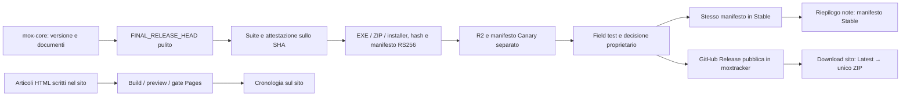

# Draft Omen e MOX: audit indipendente di prodotto, sito, Privacy, Docs e News

**Mandato:** 14 ottobre 2026. **Autore:** Codex. **Perimetro:** analisi e report; nessuna modifica applicativa, merge, PR, deploy, release, migrazione o scrittura Cloudflare. Repository di consegna pubblico: `Dennis96/moxtracker`. Branch: `codex/audit-draft-omen-vs-mox-site-news-2026-10-14`, da `a08ee510152044b544ecdec014dd0876fd3920b0`.

**Stato della consegna:** analisi completata; verifiche iniziali e limiti in §12. Approfondimento Draft richiesto successivamente dall'utente, con prove sintetiche offline e nuova fotografia live, in §13. I permalink e gli SHA dei commit documentali sono nelle consegne della chat e nella storia Git di questo file. Il documento non incorpora il proprio SHA, che cambierebbe incorporandolo. Tutte le sezioni propositive sono backlog, non autorizzazioni all'esecuzione.

## 1. Sintesi decisionale

**MOX non ha bisogno di imitare Draft Omen nel suo insieme. Deve comunicare qualità che possiede già e migliorare alcuni componenti del Draft.** Il sito MOX mostra bene il companion completo e dispone di una Privacy sostanziosa, ma News e documentazione del metodo non sono tenute allo stesso livello del prodotto. Draft Omen comunica meglio il singolo problema del Draft, rende il metodo consultabile e mantiene una cronologia reale delle release. L'approfondimento §13 identifica vantaggi strutturali del builder Omen, della scelta congiunta Pick-Two MOX e della lettura del mana MOX, oltre a un limite riprodotto del simulatore MOX. Non è dimostrata la superiorità complessiva di uno dei due sui risultati delle partite.

Le cinque differenze che incidono davvero sulla decisione:

1. **News:** MOX ha 27 release pubbliche GitHub, tutte non draft e non prerelease; il sito ne racconta soltanto tre. Le ultime 2.11.8, 2.11.3 e 2.11.2 mancano dalla cronologia, mentre il riepilogo dinamico vede correttamente la Stable 2.11.8. Draft Omen mostra tutte le sue 11 release stabili, inclusa 0.6.4, escludendo la prerelease rolling `development`. Vantaggio netto del sito Draft Omen, non del suo algoritmo. [N1] [N2] [T1] [O8]
2. **Docs:** Draft Omen collega da menu e home un percorso sul funzionamento, poi documenti pubblici su scoring, parser, builder, audit e benchmark. MOX ha già una buona guida dentro Download, ma la nasconde dietro CTA che scaricano direttamente e non espone un ingresso Docs. La priorità è un indice per utenti e tester, non pubblicare i canonici interni. [T2] [T3] [O1] [O2]
3. **Privacy:** MOX è più completo nel dichiarare titolare, finalità, basi giuridiche, consensi, retention, cancellazione e supporto riservato. Draft Omen è più semplice perché non raccoglie contributi di gioco nel proprio servizio. MOX deve distinguere con chiarezza contributi facoltativi e richieste tecniche per scaricare dati: spegnere condivisioni non equivale ad assenza di rete. La nuova centralizzazione riguarda la Canary 2.11.9; non va attribuita alla Stable 2.11.8. [T4] [T5] [M2] [O3]
4. **Prodotto:** MOX offre Pick-Two con valutazione della coppia, alternative di mazzo, scelta 16/17/18 terre, mana base simulata, raccolta e statistiche personali, account, Meta e supporto privato. Draft Omen aggiunge un frontend Qt/QML, macOS, replay/backtest accessibili, profili distribuiti e Augmented Intelligence opzionale. Sono vantaggi di ambiti diversi, non una classifica per numero di funzioni. [M3] [M4] [M5] [O4] [O5] [O6]
5. **Qualità delle prove:** entrambi separano scoring dalla rete e hanno strumenti scientifici. I benchmark pubblici Draft Omen misurano accordo con trophy picks; MOX usa anche Diamond/Mythic, proxy del pool e gate di ricerca con risultati negativi. Le popolazioni e gli endpoint non coincidono. Un incremento di accordo interno a un progetto non dimostra superiorità rispetto all'altro, né aumento del win rate sul campo. [M6] [O7] [O9]

**Raccomandazione News unica:** generazione statica da GitHub Releases pubblicate, con snapshot verificato e controllo al gate Stable, mantenendo preview e autorizzazione Pages separati. È un'ibrida A+C (§6), senza richieste GitHub per ogni lettore della cronologia. La raccolta dati può essere automatica; la comparsa sul sito statico segue il deploy Pages approvato. Non promettere aggiornamento istantaneo della pagina senza autorizzare anche una modalità di pubblicazione automatica.

**Prime cinque azioni:** News verificata; scoperta di Aggiornamenti e Guide; disclosure rete/fonti e data Privacy; guida iniziale e Draft; studio delle spiegazioni di pick e delle deroghe del builder. Le prime quattro sono accorpabili in un solo macro-task sito/documentazione; la quinta richiede studio e verifica separati. Nessun P0 tecnico o trattamento illecito è stato dimostrato da questo audit.

## 2. Identità, chiusura di Claude e stato realmente pubblicato

### 2.1 Fotografia Git

Preflight: checkout primarie core e tracker pulite, nessun file occupato nel registro core per il lavoro di Claude; rimangono field test di Dennis/tester. Non sono state prese in uso le worktree di Claude. Gli SHA del briefing sono fotografie precedenti, non gli HEAD finali.

| Oggetto | Identità verificata | Evidenza e interpretazione |
|---|---|---|
| `mox-core/main` remoto e locale | `67c683e36e5ee82beeb85e21effc6677991028c2` | PR #40 di chiusura documentale merged il 14/10 alle 18:25:53 UTC; dopo PR #39 di integrazione, merge `9dea6a6a311778f64420d0b657fbeecb523ef45a` alle 18:17 UTC. [G1] [G2] |
| Sorgente Canary installabile | `aa32b06da6c7f2f5a078e5410f1dc16345bd365a` | `FINAL_RELEASE_HEAD` 2.11.9. Non confonderlo con il successivo merge documentale. [M1] |
| `moxtracker/main` remoto e locale | `a08ee510152044b544ecdec014dd0876fd3920b0` | PR #41 merged il 14/10 alle 18:26:01 UTC; PR #40 di codice/configurazione merged alle 17:45:26 UTC con SHA `5eb5cb04376d8b9e079ef00a4e1d951ce3f2d025`. [G3] [G4] |
| Sorgente Stable 2.11.8 | `86fe7c0daf0a4bac80f014737960654e2424e96e` | Provenienza presente nelle note GitHub 2.11.8 e nella procedura/handoff. [N1] [M7] |
| `mox-meta/main` remoto | `7057c8d418e331e19f45fc6b1711ee9aaf934e28` | Primario locale `ec2f924`, indietro di due commit: non aggiornato. Ruolo generated-only; nessun contenuto modificato. [M8] |
| Draft Omen `master` remoto | `b39d518deb41559f38d7c5a58c0de2159d19659e` | Commit del 14/10, 06:41:10 UTC, refresh dati del sito. È 46 commit avanti rispetto al tag 0.6.4; non è una nuova release installabile. [G5] |
| Draft Omen release Latest | `v0.6.4`, pubblicata 05/10/2026 13:14:34 UTC | Tag annotato `a77c4e4e088e1cd6f168e137c78b0ce05afd5777`, commit risolto `dc9f5ece2d54bc0eccfcbdc8a4a8b66752e78b84`. È la baseline del codice concorrente letto. [N2] |

La catena FAIL Codex → remediation → PASS Claude esiste realmente: report `ffc0d75b09d370b15b79c81839ef6d814bc00df2`, poi `6deb9db740ece42c63d9a59f7d8114d4045cdf3a`; il secondo chiude 3 BLOCKER, 4 MAJOR e 3 MINOR, lasciando due nuovi MINOR poi trattati nell'integrazione. I due report sono stati letti da Git, non dedotti dal messaggio di Claude. La chiusura documentale è merged. [M9] [M10] [M1]

### 2.2 Verifiche live indipendenti

Acquisizione HTTP del 14/10, **20:32:01–20:32:08 Europe/Rome**; campione delle coppie **20:40:11–20:40:16**. L'ora esatta UTC è conservata per ogni richiesta nell'inventario locale. Solo GET pubblici, senza account, token applicativi, invii di log o richieste ai dati personali. Le normali registrazioni tecniche delle richieste non sono una mutazione funzionale del servizio.

| Superficie | Risultato indipendente | Limite |
|---|---|---|
| `/mox/release?...canale=stable&corrente=0` | HTTP 200, `2 beta 2.11.8`, installer 67.247.524 byte, SHA `84f72416abaecbddc05b9f33e160177529ede8dc295e54772847a4d666c8ca3c`; firma RS256 **valida**, verificata in Node con la chiave pubblica del client. | Installer non riscaricato o eseguito da questo audit. |
| `/mox/release?...canale=canary&corrente=0` | HTTP 200, `2 beta 2.11.9`, installer 67.283.028 byte, SHA `39f84dc63aa0da8dcec5a74702c362d4d8ba53900207e045a105abda7b5ad02a`; firma RS256 **valida**. | Il 16/16 dell'aggiornamento reale è un risultato di Claude, non una prova ripetuta qui. |
| GitHub Releases Latest MOX | `mox-v2-beta2.11.8`, ID `406702253`; non draft/prerelease, ZIP 110.267.929 byte e digest SHA-256. Nessuna GitHub Release 2.11.9 nell'inventario completo. | Digest verificato come metadato GitHub; non ricalcolato scaricando lo ZIP. |
| Policy pubblica | `enabled`, `central_api`, `basis=owner_decision`, `configurata=true`, aggiornamento 17:50:19 UTC. | Non è permesso di 17Lands; la richiesta del 28/09 è ancora dichiarata senza risposta. Decisione del proprietario assunta e non riaperta. |
| `/salute` | Research `on`, qualification `valida`, ID `q-produzione-2026-10-14`. | La scadenza **15/11/2026** è verificata in configurazione/handoff; l'endpoint salute non espone la data. Nessuna lettura amministrativa o rinnovo. |
| Manifesto Public Data Sets | HTTP 200, 44 entry ECL/SOS/TLA/TMT, `public, max-age=300`; SHA `56b39389e8af106567bcf6d2d0b649732d390c683aa88ad0f49fc17a99dc3fec`, coerente con handoff. | Primo manifesto acquisito; non ricalcolati i CSV grezzi. |
| Payload pubblici, seconda fotografia 21:09 | Globali ECL/SOS/TLA/TMT tutti HTTP 200; SHA locali uguali al manifesto e a `x-mox-sha256`, cache immutable annuale, attribution CC BY 4.0 e modifiche dichiarate. | Quattro globali verificati; le quaranta tabelle di coppia pubbliche non tutte riscaricate. |
| FRA globale | `card_data` e `color_ratings` HTTP 200 per Premier/Traditional/Pick-Two/Quick; `private, no-store`. Hash locali uguali a `x-mox-sha256`. `generated_at=2026-10-14T18:23:52.369Z`. | Disponibilità osservata al momento, non monitoraggio continuo del cron. |
| FRA coppie | Premier **10/10**, Traditional **10/10**, Pick-Two **WU/WB 2/10**, Quick **0/10**; mancanti HTTP 404. | Il giro delle 21:23 non era ancora avvenuto: non certificato qui. |
| Pages MOX | Build `83b81f0227530856`, `commit_git=3bc05da6b0c37d51016e315638e0d87059e9a9e5`, 91 file. Build locale da tracker `a08ee51`: stessa build e **91/91 hash del manifesto identici**. | Il manifesto live è confrontato con la build; non sono stati riscaricati tutti i 91 asset. Le pagine principali sì. |

**Una sottigliezza decisiva per le future News:** la risposta richiesta sul canale Canary contiene anche `canale: "stable"` nel corpo firmato. Non è prova di promozione: il manifesto viene preparato per essere riusato byte per byte in Stable, mentre il Worker seleziona il secret in base al parametro della richiesta. Qui le firme sono valide e le versioni differiscono correttamente. Classificare una News dal solo campo interno `canale` pubblicizzerebbe falsamente la 2.11.9 come Stable. Usare distribuzione/Release pubblicata e ricevuta del gate; mai quel campo isolato. [T6] [M7]

Anche gli hash dei manifesti vanno distinti: `33041aaf…` nel handoff è il file firmato originale; `a5fd64d7…` è il corpo JSON HTTP ricevuto, con serializzazione della risposta. La verifica della firma usa la forma canonica, non il confronto fra queste due serializzazioni. Nessuna discrepanza crittografica è emersa.

**Riconciliazione del cron:** il racconto «solo le coppie Premier al primo giro» è incompleto rispetto al live. Otto tabelle globali + ventidue coppie disponibili fanno **30**, coerenti con il tetto del raccoglitore. Tutte hanno il timestamp del primo giro. Non occorre ipotizzare un secondo deploy o un cron anticipato. Le coppie rimanenti sono ancora pendenti nella fotografia. [T7]

Premier ha **290 carte; 279 GIH con almeno 500 partite**, più **4** carte utilizzabili tramite GP ricentrato: **283** righe con il criterio client. Quindi 279 e 283 non sono numeri contraddittori: contano categorie differenti. L'audit ha riprodotto il conteggio dai payload; non ha aperto un Draft personale. Per gli altri formati: Traditional 237 GIH + 25 GP, Pick-Two 255 + 13, Quick 217 + 28. Non trasformare queste numerosità in una misura di qualità del ranking. [M2]

**Chiusura Canary:** pubblicazione e handoff finale conclusi e verificati; resta un difetto di allineamento nei canonici d'area (§2.3). Field test 2.11.9 ancora necessario. Stable invariata. Nessuna nuova attestazione della suite di release, dello storage privato o dei log Cloudflare è stata prodotta da questo lavoro.

**Seconda fotografia, 21:09 Europe/Rome:** SHA remoti core/tracker/Omen invariati rispetto alla baseline; non è stato necessario rileggere il progetto. Payload pubblici globali verificati direttamente: ECL 288 carte, dati pubblicati 18/05/2026; SOS 331, 05/06/2026; TLA 342, 10/01/2026; TMT 210, 08/04/2026. I conteggi sono record del payload, non carte riconosciute da tutti i client né copertura completa di ogni ristampa. TMT ha SHA `ae1ca8244de7e6e6319f0ef0fbca04ea670342adf0f88031dd01ed0b60f0da91`, identico al riferimento di Claude.

### 2.3 Correzioni al briefing e documenti ancora imprecisi

- `/sets/` Draft Omen mostra oggi **22**, non 20, set con rating; il manifesto distingue **50 set riconosciuti**, 22 con dati e 28 senza. I modelli Augmented presenti sono DFT/HOB/WOE; FRA ha profili `early` dei quattro formati, **nessun modello Augmented**. TMT è riconosciuto, con metadati, ma senza profilo nel manifesto corrente. [L2]
- `STATUS.md` e `STATO-CORRENTE-SITO.md` sono aggiornati alla 2.11.9 ma conservano SHA di integrazione e righe che nominano ancora entrambe le 2.11.8; sono leggibili come cronologia, poco chiari come snapshot. Non attestano una falsa Stable se confrontati con il live.
- Il canonico d'area `passaggi/draft/STATO-DRAFT-CORRENTE.md`, in testa, dice ancora A141 «DECISION PENDING, release bloccata» e review pendente. È **CONTRADDITTORIO come stato corrente** rispetto a STATUS, handoff, Git e release effettiva. La chiusura operativa è conclusa; non tutti gli ingressi documentali sono riconciliati. Il prossimo lavoro documentale deve correggere il solo stato corrente preservando gli archivi e le qualifiche scientifiche esplorative.
- Il commento iniziale `src/dati-draft.js:19` dice ancora che il binding non esiste, mentre configurazione e risposta live provano il contrario. È **STALE**, non un difetto operativo della distribuzione.
- La Privacy live porta «Aggiornata il 26 settembre 2026», ma include la disclosure A141 pubblicata il 6 ottobre. Metadato **STALE** da correggere nel prossimo task contenuti. [T4] [T8]
- Il tag Omen 0.6.4 contiene ancora il sito con package 0.6.3 e nessuna voce News 0.6.4; la procedura aggiorna il sito **dopo** la release, con PR separata. Il live/master aggiornato non deve essere scambiato per il tree del tag. Questa separazione è intenzionale. [O8]

## 3. Metodo e forza dell'evidenza

Ordine seguito: istruzioni locali e policy workspace → stato/lavori/arretrati → procedura release, handoff e runbook mirati → Git remoto, Releases e manifesti live → siti e browser → codice release pinned → backlog. Nessuna discovery generale di D1/Research o riapertura degli esperimenti Draft.

**VERIFICATO LIVE:** risposte HTTP, DOM, immagini viste nel browser, metadati GitHub, misura dei layout. **VERIFICATO SORGENTE:** lettura di codice/tag/documento specifico, senza implicare prova sul binario. **RIFERITO:** test o certificazione eseguiti da Claude, fonte identificata. **INFERENZA:** conseguenza motivata non misurata sul campo. **PROPOSTA:** comportamento futuro. **NON VERIFICATO:** accesso o prova non svolta. **STALE/CONTRADDITTORIO:** discordanza puntuale, non giudizio globale sul progetto.

Codice MOX: ranking/builder Stable confrontati col `FINAL_RELEASE_HEAD` 2.11.9; `draft_valutazione.py` è identico fra le due release. Cambiano acquisizione e provenance, non quella politica di ranking. Codice Omen: archivio sorgenti ufficiale del tag 0.6.4, letto senza installazione o esecuzione nella prima fase dell'audit. Nell'approfondimento §13 sono state eseguite esclusivamente librerie di calcolo su ingressi inventati, con rete e accesso a dati personali impediti; nessun client è stato avviato. Il confronto Git tag→master serve a separare sviluppi successivi; non attribuisce automaticamente nuove funzioni alla release.

Browser reale integrato: home, Download/Docs, Privacy e News di entrambi; viewport 375/390/768/1440, **dopo caricamento CSS**. Verificati menu, struttura, immagini e alcuni stili. Non è una certificazione WCAG, Lighthouse o un field test desktop dei client. I primi rilievi transitori prima del caricamento CSS sono stati scartati.

Le pagine non accessibili al tool di ricerca testuale sono state raggiunte con HTTP e browser: **non si tratta di indisponibilità dei domini**. Non sono stati inventati screenshot, tempi di avvio applicativi, win rate comparativi o esiti su account.

## 4. Matrice tecnico-funzionale

La colonna «vantaggio» specifica il contesto: può essere reciproco, indimostrato o non confrontabile. «Disponibile nel sorgente rilasciato» non significa che il suo uso sia stato collaudato in un Draft vero da questo audit.

| Area | MOX Stable 2.11.8 / Canary 2.11.9 | Draft Omen 0.6.4 e dati live | Vantaggio e prova |
|---|---|---|---|
| Target e primo valore | Companion partite, Draft, mazzi, collezione e web; più decisioni di onboarding. | Specialista Draft, promessa iniziale più corta e immediata. | Omen per chi cerca solo Draft; MOX per continuità prima/dopo partita. Live + [O1] [T2]. |
| Sistemi/distribuzione | Windows, ZIP runtime GitHub; autoupdate proprio. macOS non documentato come supportato. | DMG Apple Silicon/Intel, Windows Store e EXE unsigned GitHub; TUI da sorgenti. | Omen per copertura macOS/Store. Versione corrente Store **non verificata**, non presumere 0.6.4. [N2] [O10]. |
| Firma e aggiornamento | Manifesti RS256 validi, hash/size, artefatti immutabili, canali distinti e promozione dello stesso installer. | DMG dichiarati firmati/notarizzati; Store gestisce aggiornamenti; EXE standalone avvisa e collega al download, non si auto-installa. | MOX per updater standalone e rollback controllato; Omen per percorso Store/macOS. RS256 non è Authenticode né reputazione SmartScreen. [M7] [O10]. |
| Privacy di default | Condivisioni spente, account facoltativo; richieste tecniche necessarie ai servizi. | Nessun backend di contribuzione automatica dei draft; identità e audit locali; dati/profili remoti. | Omen minimizza infrastruttura personale; MOX offre più controllo sui servizi cloud che effettivamente ha. [T4] [O3]. |
| Formati Arena | Premier, Traditional, Quick, Pick-Two; log/sessioni e ripresa. | Stessi quattro, con Traditional dichiarato verificato solo su sintetico. | Copertura nominale simile; non equiparare copertura nominale e prova sul campo. [M4] [O2] [O1]. |
| Log incompleti/rotazione | Gestione sessioni, ripresa e quarantena; non ricostruire offerte assenti inventandole. Field test residui dichiarati. | Linee complete, startup scan/rotazione, account differenti; offerte mancanti senza consiglio, pool finale usato per builder. | Nessun vincitore universale senza corpus identico. Omen documenta bene limiti del parser. [M4] [O2]. |
| Pack/Pick e account | Identità sessione locale distinta anche se Arena riusa l'evento; invio solo con consenso. | CourseId/draft identity, account locale e draft accountless differiti; fix Windows dei due punti rilasciato 0.6.4. | Entrambi trattano problemi reali, diversi; binari non rigiocati qui. [N2] [M4] [O2]. |
| UI durante il pick | Tk, layout compatto, percentuale reale/stima/ATA, giudizi, score MOX, pool/segnali, coppia Pick-Two. | Qt/QML più coerente, tabella e focus card; TUI con ordinamenti alternativi e motivi in dettaglio. | Omen per struttura visiva coerente e accesso al metodo; MOX conserva priorità leggibili anche senza dati. Valutazione da screenshot pubblici e sorgenti. [M2] [O4]. |
| Spiegazione del consiglio | Compatibilità, score, campione/intervallo e contesto A141; ancora parte della spiegazione in diagnostica/tracce. | Motivi e scomposizione conservati; messaggi per pick aperto/vicino e splash/fixing. | Studiare Omen per «perché» e casi incerti; non è una misura di pick migliore. [M2] [O4] [O6]. |
| Dati visibili | GIH, stima GIH da GP, IWD, ATA, sample, Wilson; fonte/classe/format. | GIH risolta, grade, ALSA, sample/source e fallback; con profilo il valore è già regolarizzato. | MOX distingue più metriche; Omen espone bene alternative. «Raw GIH» del sito Omen è troppo generale per righe Profile. [M2] [O4]. |
| Campione/fallback | Minimo client 100; GIH → GP ricentrato → ATA → prior 0,54. Sceglie un dataset di formato con maggiore copertura se necessario; si ferma al 60% utile. | Soglia GIH 500, fallback anche per carta/pair own-format→Premier→prior 0,55/ALSA. Empirical profile prevale quando valido. | Nessuna soglia migliore a priori. MOX recupera GP; Omen mantiene granularità dei formati per carta. [M2] [O4]. |
| Regolarizzazione | Policy rilasciata `confidenza="nessuna"`; Wilson disponibile e mostrato, non attivo come score di default; shrinkage opzionale di ricerca. | Profili con shrinkage beta-binomial, forza prior 500 giochi; evita seconda shrinkage sulle stime già regolarizzate. | Omen per uso operativo della regolarizzazione; adozione MOX da dimostrare con benchmark, non copiare k. [M3] [O11]. |
| Colori/commitment | Segnali, nucleo, fixing, rampa 1,25, pavimenti Pack 2/3, hard lock da 28, CN15/C5 e mana ibrido semantico. | Prime 5 scelte aperte, rampa dal pick 6, massimo commitment dal 16, moltiplicatori on/off/splash. | Policy diverse. Il «lock» Omen è una penalizzazione moltiplicativa, non automaticamente l'esclusione rigida MOX. [M3] [O4]. |
| Curve e creature | Termini strutturali sul pool compatibile; non un Deck Score calibrato. | Contesto/ruoli opzionali; GUI contextual scoring **off** di default; engine API default **on**. | Separare default utente e API. Non attribuire ogni feature contestuale al primo avvio Omen. [M5] [O4]. |
| Archetipi e pair-rate | Tie-break complessivo coppia, non sostituzione del GIH carta×coppia nel Pick Advisor. A1 builder non promosso. | Tie-break early con finestre e campioni; profilo empirical/pair e fallback controllati; modelli card-pair opzionali. | Omen ha più percorsi di contesto rilasciati; vantaggio quantitativo non dimostrato. [M3] [M5] [O4]. |
| Pick-Two | Valuta combinazioni, ciascuna nei due ordini e media; considera fasce. A142 è un limite noto di ordine visivo, non della coppia. | Scoring singolo; consiglio top card, métriche per entrambe e conteggio di quante top-2 scelte. | MOX ha una valutazione congiunta esplicita. Da verificare empiricamente che dia coppie migliori. [M3] [O4]. |
| Builder | Tre combinazioni a confronto; 40 carte con 16/17/18 terre; castability semantica; completa coppie insufficienti con minimo splash. | Ottimizzatore bounded beam/local improvement, vincoli su creature/curva, splash conservativo, bench e deroghe spiegate. | MOX per confronto alternative e mana simulato; Omen per vincoli e reporting delle deroghe. [M5] [O5]. |
| Mana e splash | Simulatore delle aperture, fonti reali richieste per splash facile; terra count scelto dall'utente. | Pips/floor sette fonti colore principale, 3/4 fonti per uno/due splash, massimo una base pianificata. | Approcci diversi. Le fonti Omen non sono una simulazione della probabilità di lanciare ogni curva. [M5] [O5]. |
| Export/editor/integrazione | Copia/esportazione dei mazzi personali nel prodotto; sincronizzazione privata opt-in. Non modifica Arena automaticamente. | Build sheet CLI e viste GUI/TUI; un export del mazzo in Arena o negli appunti non è stato verificato. `export-set-data` esporta dati del set, non dimostra export dei deck. | MOX documenta il flusso dei mazzi personali. Nessun test end-to-end di export fatto qui; non promettere un editor completo per analogia. [T2] [O1] [O5]. |
| Fonti/rete | Stable usa ancora il percorso diretto policy-controlled; Canary 2.11.9 acquisisce statistiche dal Worker e Public Data Sets, scoring locale. | Live normale usa profili/metadata ospitati, cache locali; strumenti/percorsi legacy possono raggiungere provider direttamente. | MOX 2.11.9 limita destinazioni delle statistiche; Omen riduce costo dell'infrastruttura usando artefatti statici. Non dire «mai rete» per nessuno. [M2] [O4] [O3]. |
| Cache, revoca, offline | Separazione API/public, SHA, lease/policy e kill switch; nuovo processo senza policy parte off. API server private/no-store; fallback pubblici/cache governati. | Cache profili con manifest TTL 24 h, hash, origine controllata e last valid; scoring senza rete. | MOX per revoca remota operativa; Omen per disponibilità di un tool locale. Possibilità offline dipende dai dati già presenti. [M11] [O12]. |
| Set attuali | FRA API quattro formati; ECL/SOS/TLA/TMT Public Premier+10 coppie; catalogo Arena non equivale a statistiche. | 22 rated/50 recognized; FRA early quattro formati, TMT metadata-only; Augmented solo DFT/HOB/WOE. | MOX documenta qui TMT disponibile; Omen ha inventario pubblico più ampio. Non comparare 44 tabelle MOX con 22 set Omen come la stessa unità. [L1] [L2]. |
| Augmented/ML | Ricerca D3 negativa per candidata provata; D4–D6 non aperte; Research opt-in non significa consigli ML disponibili. | Augmented è presente nel tag, off di default; artefatti limitati a set/modello/formato supportato; bounded delta ±8. | Omen ha percorso opzionale operativo; efficacia comparativa e garanzia prospettica non verificate. [M6] [O9] [O13]. |
| Replay/audit/backtest | Tracce locali, replay e strumenti tecnici; A141 server solo col consenso Draft e whitelist. | Audit append-only locale con snapshot candidati/config, replay/backtest e modi UI/TUI. | Omen per accesso utente e riproducibilità locale della decisione; MOX per collegamento autorizzato partite/mazzi. [M4] [O6]. |
| Meta/Research/account | Valore distinto: statistiche, dati pubblici con soglie, archivi privati, sync e supporto. Analisi/suggerimenti Research ancora roadmap. | Nessun servizio equivalente di account, Meta o contributi aggregati dichiarato. | MOX; confronto non applicabile al solo Draft. Non forzare Omen ad avere un cloud che non serve al suo target. [T4] [M8] [O3]. |
| Test e manutenzione | Gate release con fonte/attestazione, review, sintetici e corpus privato; arretrati e deroghe dichiarate. | CI/tag, checksum asset, fixture/parser, dominio/adapters/QML e gate output sito. | Entrambi hanno discipline reali. Conteggio dei test/issue non è qualità comparativa. [M7] [O8]. |
| Performance | Modulo ranking puro; carico dati avviene prima del Draft. Ottimizzazione parser TMT 35,8 s riferita nel handoff, non rimisurata. | Scoring locale; refresh in worker; builder con limiti espliciti di ricerca. | Nessun vincitore su latenza/RAM/CPU; manca test stessa macchina/stesso snapshot. [M1] [O5]. |
| Comunicazione/contributi | Sito bilingue IT/EN e client con più lingue; repo distributivo pubblico ma client privato; ticket riservati. | README/source MIT, docs e issue pubbliche, sito English; più facile studiare/contribuire al client. | MOX per lingua italiana/supporto privato, Omen per accesso al codice e discussione tecnica pubblica. [T2] [T4] [O1] [O14]. |

## 5. Audit del sito per pagina, grafica e user journey

### 5.1 Home e About

**Draft Omen:** titolo breve, specializzazione riconoscibile, CTA macOS/Windows con canale e architettura; quattro passaggi dal log al mazzo e due schermate apribili. Il visitatore trova subito Docs, Sets, News e Privacy. Il sistema visivo scuro con sans serif, accento viola e spazio ampio crea continuità con Qt/QML. È efficace per un unico compito. I limiti sono la lingua unica, il testo tecnico sotto le CTA e una schermata iniziale occupata in parte dal logo; il titolo da solo comunica meno precisamente la funzione rispetto alla frase descrittiva. [O1] [O15]

**MOX:** la home descrive esplicitamente tracker, Draft, mazzi e statistiche, con schermate del prodotto e del web, una sezione Research che separa disponibile/in sviluppo/pianificato. Questa distinzione è utile e va preservata. Serif nei titoli, viola, icone e immagini reali danno un'identità riconoscibile; le schermate sono una prova del prodotto, non un mockup da scambiare per funzionalità rilasciata. La home è però lunga e manca un percorso secondario immediato «Inizia / Guide» e «Aggiornamenti». La CTA Scarica avvia lo ZIP tramite resolver: non porta alla pagina Download, che contiene molto dell'onboarding. [T2] [T3]

**Decisione:** conservare identità e quattro momenti MOX, aggiungere accanto al download un accesso alla guida iniziale e una riga «Novità nella Stable» generata dalla release effettiva. Non importare la promessa di un semplice specialista Draft se si vuole vendere il companion completo. Una pagina «Il progetto» può raccogliere scopo, sviluppatore, limiti e roadmap senza moltiplicare il menu; è P2/P3, dopo News/Guide.

### 5.2 Download e installazione

Omen riduce attrito Windows tramite Store e supporta due architetture macOS. È un vantaggio reale di distribuzione, ma lo stato della submission Store può seguire tempi diversi dal tag GitHub: non pubblicizzare sul sito una versione Store non verificata. Il README offre anche EXE unsigned e avviso manuale; l'audit non ha verificato firma dei DMG né installato alcun pacchetto. [O10]

MOX ha già un percorso dettagliato: estrarre ZIP, avviare EXE, Detailed Logs, strumenti, consensi/account e avvio alternativo `.bat` se Windows blocca. Il testo raccomanda di mantenere le protezioni Windows. La firma crittografica dell'updater non equivale a certificato Windows dell'EXE: le nuove Docs devono dirlo con un linguaggio semplice e rimandare al supporto, senza introdurre una procedura generale per disattivare Smart App Control. [T2] [M7]

Opportunità a basso rischio: una guida da tre passi con link preciso a Download, un indice interno per chi aggiorna, una pagina problemi d'installazione. Evitare di duplicare tutta la guida in home, FAQ e Docs: assegnare la fonte editoriale a una sola pagina e linkare gli altri ingressi.

### 5.3 Docs

Omen ha una buona **spiegazione del meccanismo**, con limite di certezza e link alle fonti tecniche. Non è una documentazione ideale per ogni utente: installazione Detailed Logs e troubleshooting si trovano anche nel README, e il passaggio a GitHub può interrompere il percorso di un utente normale. La pagina live e alcuni documenti storici dicono «raw GIH» o ML futuro, mentre la release usa profili già regolarizzati e Augmented opzionale. Il pubblico e il tecnico non sono ancora completamente riconciliati. [O4] [O9] [O15]

MOX ha l'onboarding, ma lo presenta come Download; la pagina Draft parla soprattutto di prodotto/metodo generale, non di come interpretare una riga senza dati, GP ricentrato, campioni, formato fallback o stato `public_only`. Il miglioramento più utile è una IA pubblica con un percorso breve e capitoli mirati (§8), con provenienza/versione del comportamento. Non serve esporre runbook di rollback, procedure cloud, corpus privati o contratti congelati.

### 5.4 Privacy

La pagina Omen è leggibile perché il trattamento è più piccolo: account Arena e audit locali, cache, terze parti, assenza di analytics nel sito. La Privacy MOX è più lunga, ma le prime risposte aiutano e il supporto riservato è un vantaggio concreto rispetto a un'issue pubblica. **Non accorciare MOX togliendo informazioni necessarie per imitare Omen.** Servono un indice per ancore, una tabella dei flussi e la separazione fra dati di gioco inviati e rete tecnica. Analisi completa in §7.

### 5.5 News

Omen: elenco cronologico, pagina per release, data, Latest, numero di cambiamenti e contenuto dell'ultima versione. Le voci tecniche sono talvolta verbose; la 0.4.0 elenca 208 cambiamenti, una misura poco utile per il giocatore. Da studiare fonte/gate, non copiare il numero dei cambiamenti o un wall of text. [O8]

MOX: pagina leggibile e riepilogo dinamico corretto, ma cronologia incompleta e nascosta nel footer. Un visitatore può interpretare 2.11.1 come ultimo aggiornamento narrato, nonostante la riga corrente 2.11.8. Il link GitHub recupera l'informazione per utenti che sanno cercarla, ma non risolve discoverability, lingue e coerenza storica. La data 2.11.1 in pagina è 24/09; `published_at` GitHub è 25/09 alle 05:38:17 UTC, cioè 07:38:17 a Roma. È una differenza di date reali, non un fuso orario. [T1] [N1]

**Nome preferito nel menu: «Aggiornamenti»**, comprensibile anche a chi non conosce il termine release. H1 «Note di versione»; EN «Updates» / «Release notes». `News` sarebbe adatto anche a notizie del progetto, ma oggi il bisogno principale è sapere cosa è stato pubblicato. «Note di versione» è preciso ma lungo nel menu mobile.

Menu desktop futuro: Home, Meta, Draft, Guide, Aggiornamenti; Il mio MOX e Scarica come azioni separate se il collaudo a 768 px conferma lo spazio. Supporto resta un ingresso nella pagina Guide, nel footer e nel menu mobile. **Non rimuoverlo automaticamente:** alternativa conservativa è mantenere il menu esistente e aggiungere un gruppo «Aiuto» accessibile con Guide/Aggiornamenti/Supporto. Il macro-task successivo deve scegliere e testare un'opzione, non aggiungerle tutte. Sul mobile Guide, Aggiornamenti e Supporto devono essere link espliciti, non raggiungibili solo scorrendo il footer.

### 5.6 Sets e pagina Draft pubblica

Omen ha un inventario generato che distingue riconoscimento delle carte, rating e modelli. È particolarmente utile per FRA/TMT: FRA ha quattro profili early; TMT ha metadati ma non profili nel manifesto corrente. Il sito non specifica direttamente in tabella formato, maturità, data e licenza per riga; questo limita l'utilità della spunta «supported». [L2]

MOX `/draft` separa prodotto e vista aggregata futura; non finge che Limited pubblico sia già disponibile. Va mantenuto. Manca un prospetto «Fonti disponibili adesso», ricavato da metadati realmente distribuibili: set, formato richiesto/usato, classe, data, copertura e limite. Sarebbe più utile di una semplice lista di set supportati. Evitare che la presenza nel catalogo Arena venga scambiata per dati 17Lands o per un modello addestrato.

### 5.7 Responsive, accessibilità, SEO e performance

Misura dopo `load`, stesso tab per evitare che il cambio viewport si applichi a un'altra scheda. Una scrollbar verticale di 15 px riduce la larghezza client: si confrontano `scrollWidth` e `clientWidth`, non soltanto `innerWidth`.

| Pagine controllate | 375 px | 390 px | 768 px | 1440 px |
|---|---|---|---|---|
| MOX Home/Download/Privacy/Note | 360/360 | 375/375 | 753/753 | 1425/1425 |
| Omen Docs/Privacy/News | 360/360 | 375/375 | 753/753 | 1425/1425 |
| Omen Home | **369/360** | **385/375** | **780/753** | 1425/1425 |

Valori `scroll/client`: Omen Home ha overflow misurato di 9/10/27 px. Non è una prova di testo importante perso; il rilievo resta MINOR da investigare sul suo layout. Non emerge overflow nelle pagine MOX campionate. Tutte le 32 combinazioni hanno un H1 e nessuna immagine priva dell'attributo alt; presenza dell'attributo non certifica qualità del testo alternativo.

Ulteriori 28 combinazioni: MOX Draft/Supporto/Cosa invia/Privacy EN/Note EN e Omen About/Sets sugli stessi quattro viewport, tutte senza overflow e con un H1. Campione contrasto Privacy MOX: testo `rgb(167,166,178)` su pannello opaco `rgb(15,16,24)`, rapporto calcolato **7,89:1**. Omen: testo `rgb(174,184,207)` su colore base `rgb(9,13,27)`, **9,73:1** rispetto alla sola base; il gradiente radiale impedisce di trattarlo come contrasto certificato di ogni punto della pagina. Due campioni favorevoli non certificano l'intero sito.

Menu mobile MOX: apertura con bottone, `aria-expanded`, chiusura Escape e focus restituito al bottone osservati. Omen: menu nativo espandibile con Docs/News/Privacy osservato e navigazione alla News riuscita. Header e sezioni hanno gerarchia semantica e skip link. Contrasti e focus sono stati osservati a campione; non è stato eseguito un audit completo di tastiera, screen reader, zoom 200%, reduced motion o contrasto su tutte le immagini/superfici. A44 del client è già noto e non viene duplicato come nuovo difetto. [T3] [O16]

MOX live ha canonical e hreflang IT/EN/x-default coerenti, sitemap e robots produzione; la build genera questi elementi. Preview noindex/robots è un gate nel sorgente, **non un nuovo test live di una preview**. Omen ha canonical, title/description e asset locali; nessun hreflang è necessario per un sito monolingue. Il tentativo diretto `/sitemap-index.xml` ha dato 404; l'audit non conclude per questo che ogni possibile sitemap Omen sia assente. [T9] [O17]

HTTP documenti MOX: `Cache-Control: no-store`; Omen `public, max-age=0, must-revalidate`. MOX home è 18.862 byte e Omen 9.489 byte, **solo HTML**: non una misura del peso totale o delle prestazioni. Le richieste singole non costituiscono benchmark; immagini, font, rete fredda e analytics possono dominare. Conservare asset versionati e immagini responsive; prima di un redesign misurare waterfall/Core Web Vitals con campioni ripetibili, senza dedurre che un file HTML più piccolo renda automaticamente il sito più veloce.

## 6. News MOX: inventario, root cause e progetto concretamente realizzabile

### 6.1 Inventario esaustivo delle release pubblicate

Sorgente: GitHub REST, tutte le pagine tramite `gh api --paginate --slurp`, ordinamento locale per `published_at` decrescente. **27 oggetti pubblicati**, nessuno draft/prerelease nella fotografia; `Latest` verificata con endpoint separato. Le vecchie versioni con «beta» nel tag erano distribuzioni pubbliche normali: «beta» nel nome non prova Canary. Le release storiche sono classificate come distribuzioni pubbliche/stabili nella terminologia odierna; non si sostiene che il vecchio protocollo di canali fosse già identico.

Ogni tag in tabella è un link alle note canoniche. Tutti hanno un solo ZIP; le prime tre release hanno anche `.sha256`. Digest da metadati API; non download di 27 pacchetti. La presenza in sito indica un articolo dedicato, non una menzione nel riepilogo dinamico. Il sito ha anche una voce «Sito beta», che è editoriale e non una GitHub Release del client.

| Tag / link canonico | Pubblicata UTC | draft/prerelease | Latest | Note GitHub | Artefatti | Digest ZIP GitHub | Articolo sito IT/EN |
|---|---|---|---|---|---|---|---|
| [mox-v2-beta2.11.8](https://github.com/Dennis96/moxtracker/releases/tag/mox-v2-beta2.11.8) | 2026-10-08T10:27:06Z | false/false | sì | presenti | MOX-2.11.8.zip | sha256:31b8c9faa7c4e16ef28c1c304c13dfd74037f522d2f04d48021319d5bb134c6b | no, IT/EN |
| [mox-v2-beta2.11.3](https://github.com/Dennis96/moxtracker/releases/tag/mox-v2-beta2.11.3) | 2026-09-27T12:16:36Z | false/false | no | presenti | MOX-2.11.3.zip | sha256:7770523b96147baf9d57d4111e04dd8f4087bc1f63351c53f21e15b5cc7bfd32 | no, IT/EN |
| [mox-v2-beta2.11.2](https://github.com/Dennis96/moxtracker/releases/tag/mox-v2-beta2.11.2) | 2026-09-25T10:41:53Z | false/false | no | presenti | MOX-2.11.2.zip | sha256:800ef639ab985b4c4527142957b63b062024c1c080a84190f5596cb7bbda55ec | no, IT/EN |
| [mox-v2-beta2.11.1](https://github.com/Dennis96/moxtracker/releases/tag/mox-v2-beta2.11.1) | 2026-09-25T05:38:17Z | false/false | no | presenti | MOX-2.11.1.zip | sha256:d58a079b37cd8b50a99a73745334ee61aba09122da653c769f17deb7b872c44d | sì, IT/EN |
| [mox-v2-beta2.11.0](https://github.com/Dennis96/moxtracker/releases/tag/mox-v2-beta2.11.0) | 2026-09-15T12:32:03Z | false/false | no | presenti | MOX-2.11.0.zip | sha256:803ef8d0aa4d4b6efa8c2789d52726a19a974523c0f5273979408db8427f9b66 | sì, IT/EN |
| [mox-v2-beta2.10.0](https://github.com/Dennis96/moxtracker/releases/tag/mox-v2-beta2.10.0) | 2026-09-10T12:43:10Z | false/false | no | presenti | Mox-v2-beta2.10.0-con-python.zip | sha256:82e7dc8b7671c22a29b12ea5ed5ec3ec0c124b65eafb362345655e6d2998dbd0 | no, IT/EN |
| [mox-v2-beta2.9.29](https://github.com/Dennis96/moxtracker/releases/tag/mox-v2-beta2.9.29) | 2026-09-03T05:11:49Z | false/false | no | presenti | Mox-v2-beta2.9.29-con-python.zip | sha256:1381b360fd6a30d7e74314ef190d1ae2f2b5ebd8e2acec6e27f1b81b28d239a0 | no, IT/EN |
| [mox-v2-beta2.9.28](https://github.com/Dennis96/moxtracker/releases/tag/mox-v2-beta2.9.28) | 2026-08-28T18:55:27Z | false/false | no | presenti, escape letterali | Mox-v2-beta2.9.28-con-python.zip | sha256:3c7ac8b4899edb1687e116b11f4b4576ac8704ba0b1012d742c162d5aefffcda | no, IT/EN |
| [mox-v2-beta2.9.27](https://github.com/Dennis96/moxtracker/releases/tag/mox-v2-beta2.9.27) | 2026-08-28T16:34:42Z | false/false | no | presenti | Mox-v2-beta2.9.27-con-python.zip | sha256:4c3afd7510c957c182ce488c2591fa6a0add6a76b506d629860976fed1b9f224 | no, IT/EN |
| [mox-v2-beta2.9.26](https://github.com/Dennis96/moxtracker/releases/tag/mox-v2-beta2.9.26) | 2026-08-27T18:08:26Z | false/false | no | presenti | Mox-v2-beta2.9.26-con-python.zip | sha256:7c8aec280b10427a6ecfacd3e4612911a980a65d92d14709a9347bd0bc3431f6 | no, IT/EN |
| [mox-v2-beta2.9.25](https://github.com/Dennis96/moxtracker/releases/tag/mox-v2-beta2.9.25) | 2026-08-26T20:59:38Z | false/false | no | presenti | Mox-Windows-beta.zip | sha256:48bf576f6324f1dd9a498b89879c88ca208cb8e03cfe57a9cccc9ca40a71cee8 | no, IT/EN |
| [mox-v2-beta2.9.24](https://github.com/Dennis96/moxtracker/releases/tag/mox-v2-beta2.9.24) | 2026-08-26T20:20:13Z | false/false | no | presenti | Mox-Windows-beta.zip | sha256:3910792ef6362fe0c9f9d932dbb743f43fe79b00b9d0237de5af41ca76864ea0 | sì, IT/EN |
| [mox-v2-beta2.9.23](https://github.com/Dennis96/moxtracker/releases/tag/mox-v2-beta2.9.23) | 2026-08-26T07:19:10Z | false/false | no | presenti | Mox-Windows-beta.zip | sha256:27c2e260420cc719a4f7f63d181d1118172012abf47b1b1793d0ff432460a89e | no, IT/EN |
| [mox-v2-beta2.9.22](https://github.com/Dennis96/moxtracker/releases/tag/mox-v2-beta2.9.22) | 2026-08-25T15:11:10Z | false/false | no | presenti | Mox-Windows-beta.zip | sha256:6144f45c5dff8da680b9d616809898fdda319cafbbab84ba305f14feff2dc4bb | no, IT/EN |
| [mox-v2-beta2.9.21](https://github.com/Dennis96/moxtracker/releases/tag/mox-v2-beta2.9.21) | 2026-08-25T13:40:35Z | false/false | no | presenti | Mox-Windows-beta.zip | sha256:fa72dda7c3ad7c37a6e06295892d3a10709f7551ea44dc8a4446f28e127ec9eb | no, IT/EN |
| [mox-v2-beta2.9.20](https://github.com/Dennis96/moxtracker/releases/tag/mox-v2-beta2.9.20) | 2026-08-25T12:45:49Z | false/false | no | presenti | Mox-Windows-beta.zip | sha256:ef033f3523d7738c248fa81f8a670e372921dbba36020c146d4ca04eb01e5cf9 | no, IT/EN |
| [mox-v2-beta2.9.19](https://github.com/Dennis96/moxtracker/releases/tag/mox-v2-beta2.9.19) | 2026-08-25T10:07:24Z | false/false | no | presenti | Mox-Windows-beta.zip | sha256:604729b7253d64f9375779a68fc338983af20fe359bcee129544079501891958 | no, IT/EN |
| [mox-v2-beta2.9.18](https://github.com/Dennis96/moxtracker/releases/tag/mox-v2-beta2.9.18) | 2026-08-24T15:40:06Z | false/false | no | presenti | Mox-Windows-beta.zip | sha256:469fbedc6685ded6cb50f66a7ba0ffaa3b310df644e3c9ad17380115d988fd34 | no, IT/EN |
| [mox-v2-beta2.9.17](https://github.com/Dennis96/moxtracker/releases/tag/mox-v2-beta2.9.17) | 2026-08-24T05:20:16Z | false/false | no | presenti | Mox-Windows-beta.zip | sha256:10ebd7ab69ee50c5dd4131f3d3b7b4941b6fe9900f67216fdbbfbebdc2d2db4a | no, IT/EN |
| [mox-v2-beta2.9.16](https://github.com/Dennis96/moxtracker/releases/tag/mox-v2-beta2.9.16) | 2026-08-23T21:05:22Z | false/false | no | presenti | Mox-Windows-beta.zip | sha256:7afeb631d58a69b4b26af2b95c1bf20b580dc90ac68da9b81ee21c172c62cd6a | no, IT/EN |
| [mox-v2-beta2.9.15](https://github.com/Dennis96/moxtracker/releases/tag/mox-v2-beta2.9.15) | 2026-08-23T17:23:15Z | false/false | no | presenti | Mox-Windows-beta.zip | sha256:ab3c7ceeff145d7f140d9d38176b6339ae4844353cde23f5fcabcc0f22e11e52 | no, IT/EN |
| [mox-v2-beta2.9.14](https://github.com/Dennis96/moxtracker/releases/tag/mox-v2-beta2.9.14) | 2026-08-23T13:12:26Z | false/false | no | presenti | Mox-Windows-beta.zip | sha256:5eeb84851ae83218a823529c2791e410079b9a075956a7f21f40d6d853eebe64 | no, IT/EN |
| [mox-v2-beta2.9.13](https://github.com/Dennis96/moxtracker/releases/tag/mox-v2-beta2.9.13) | 2026-08-23T08:34:54Z | false/false | no | presenti | Mox-Windows-beta.zip | sha256:6cb97dee678dbb7f8d03672a7aaebc53e114ee32e8eb5b3f8458e5451dff588c | no, IT/EN |
| [mox-v2-beta2.9.12](https://github.com/Dennis96/moxtracker/releases/tag/mox-v2-beta2.9.12) | 2026-08-22T21:29:24Z | false/false | no | mancanti | Mox-Windows-beta.zip | sha256:4bf206e4c3e01a3c01c7c46070ac745d37664eef7d821f8588208c3557e7a612 | no, IT/EN |
| [mox-v2-beta2.9.3](https://github.com/Dennis96/moxtracker/releases/tag/mox-v2-beta2.9.3) | 2026-08-21T10:59:17Z | false/false | no | presenti | Mox-Windows-beta.zip, Mox-Windows-beta.zip.sha256 | sha256:c93155663e5a03442ce853da01ba2d97e575bd237c84812cdbbd808243392673 | no, IT/EN |
| [mox-v2-beta2.9.2](https://github.com/Dennis96/moxtracker/releases/tag/mox-v2-beta2.9.2) | 2026-08-21T06:54:04Z | false/false | no | presenti | Mox-Windows-beta.zip, Mox-Windows-beta.zip.sha256 | sha256:a39042e3c0a52f3d965001ce19806655d7b40b257a16338eb7fb4f99efa6937d | no, IT/EN |
| [mox-v2-beta2.9.1](https://github.com/Dennis96/moxtracker/releases/tag/mox-v2-beta2.9.1) | 2026-08-20T19:03:48Z | false/false | no | presenti | Mox-Windows-beta.zip, Mox-Windows-beta.zip.sha256 | sha256:1e7c932c8ddcfcbe19ace5f37eb0f5f55329f7c606a2def1800fae3232dc37a3 | no, IT/EN |

**Gap:** solo 2.11.1, 2.11.0 e 2.9.24 in entrambe le lingue; **24/27 assenti** dalla cronologia. Le tre voci presenti non hanno il link dedicato al tag, quindi la provenienza è meno diretta del prospetto sopra. 2.9.12 ha body vuoto; 2.9.28 ha sequenze `\\n` letterali. Il diverso ordine restituito dall'API, soprattutto fra 2.10.0 e 2.9.29, non va usato come cronologia senza ordinamento. Per date uguali usare pubblicazione precisa e ID, non un confronto lessicografico fra versioni.

### 6.2 Catena reale attuale



La **root cause** è nell'ultimo ramo: gli articoli sono HTML manuale, senza dipendenza dalla pubblicazione GitHub. `release-note.js` aggiorna un solo nodo; `download.js` risolve lo ZIP; nessuno genera la cronologia. Il gate Pages controlla build/preview/indicizzazione, non confronta tutte le release pubbliche con gli articoli. Le prove verdi controllano ancora esplicitamente la presenza delle note 2.11.1: certificano caratteristiche esistenti, non freschezza o completezza. [T1] [T3] [T9] [T10]

Omen mantiene invece un changelog datato, lo usa per GitHub e genera Markdown News con `write_release_news.py`; il gate output controlla voce, link/download e `version.json`. Il sito viene aggiornato con PR **dopo** la release; Cloudflare Git integration pubblica quando quella PR è merged a master. È disciplina di fonte e controllo, non un feed runtime che legge GitHub ad ogni visita. Per MOX la fonte richiesta deve essere **la Release realmente pubblicata**, usando il gate per predisporne il testo, senza importare il comportamento di deploy su ogni merge. [O8]

### 6.3 Architetture A, B, C

| Soluzione | Funzionamento e costo operativo | SEO/offline/privacy | Failure mode e lavoro | Valutazione |
|---|---|---|---|---|
| **A — snapshot e HTML al build da Releases** | Un acquisitore legge lista paginata e metadata; normalizza, valida e conserva snapshot last-valid. Build deterministica da snapshot, senza rete durante il renderer. Niente nuovo Worker/D1/R2 per News. | HTML indicizzabile, leggibile senza JS/API; cronologia disponibile se i servizi esterni falliscono. Nessun IP lettore mandato a GitHub per caricare News. IT/EN generati insieme. | Senza API conservare cronologia valida e segnalarne data; bloccare l'aggiornamento incerto, non sostituire con elenco vuoto. La pagina live cambia dopo deploy Pages. Effort M. | **Preferita**, con gate C. |
| **B — fetch runtime GitHub nel browser** | Lista + Latest per visita; ETag e cache locale aiutano, ma utenti dietro stesso IP condividono limite unauth. Token mai nel frontend. Proxy Worker riduce fan-out ma aggiunge cache, gestione e richieste cloud. | Pagina iniziale meno completa per crawler/lettore senza JS; snapshot incorporato necessario per fallback/SEO. GitHub riceve dati tecnici dei lettori se fetch diretto. | Errori/rate limit, race fra badge/cronologia e localizzazione non approvata; nuova release ritirata richiede invalidazione. Effort M diretto, L con proxy robusto. | Non scelta per la cronologia; stato corrente può restare un piccolo enhancement indipendente. |
| **C — testo versionato, ricevuta e gate release** | Testo user-facing preparato una volta al gate, pubblicato nel body GitHub; ricevuta canale/provenienza/asset. Acquisizione conferma che la Release esiste prima di includerla. Richiede aggiornare processo Stable, non solo HTML. | Rendering statico come A; traduzioni approvate prima della release e storicità verificabile. Nessuna necessità di esporre attestazioni private complete. | Il solo file in un branch non prova pubblicazione; drift se si mantengono due testi manuali GitHub/sito. Effort M; integrazione della procedura da concordare. | **Complemento di A**, non una seconda fonte editoriale. |

**Costi e quote, verificati nelle fonti ufficiali:** GitHub REST unauth 60 richieste/ora per IP; richieste utente autenticate normalmente 5.000/ora. ETag con 304 non consuma il limite primario solo nelle condizioni di autenticazione indicate dalla documentazione: non promettere lo stesso a tutti i browser anonimi. Pages Free dichiara 500 build/mese e 20.000 file/sito. Workers Free 100.000 richieste/giorno; piano Standard include 10 milioni/mese e 30 milioni CPU-ms, poi $0,30/milione richieste e $0,02/milione CPU-ms. Quote account condivise; il piano effettivo MOX e CPU aggiuntiva non sono stati letti. [W1] [W2] [W3] [W4]

Assunzione di progetto A+C: 1–4 acquisizioni al giorno come rete di sicurezza, più evento Release, 1–2 richieste per lista/Latest e poche verifiche per novità; sotto dieci richieste per un refresh della storia attuale. Circa 60–240 richieste/mese per il solo polling di lista+Latest a 1–4 giri/giorno, prima delle verifiche supplementari. Eventi e build si possono accorpare. Sono **stime**, non consumi MOX misurati; accesso autenticato soltanto nel job protetto, privilegi read-only per l'acquisizione. Il costo Cloudflare incrementale della consegna statica News è stimato nullo nel piano esistente senza Functions; i minuti GitHub Actions dipendono da runner/repository/piano e non sono stati prezzati. Nessuna nuova automation è stata creata.

### 6.4 Specifica raccomandata A+C

**Fonte editoriale canonica: body della GitHub Release pubblicata.** Il gate client prepara e approva IT/EN una sola volta; lo stesso body viene pubblicato su GitHub e letto dal generatore. Uno snapshot JSON è una derivazione, non un testo alternativo da mantenere a mano. Per le release nuove, proposta di blocchi delimitati `mox-user-notes-it`, `mox-user-notes-en` e metadata canale/provenienza; delimitatori/schema esatti da definire nel contratto successivo. Nessun endpoint amministrativo o segreto nel body.

Snapshot proposto, non creato in questo task:

```json
{
  "schema": 1,
  "repository": "Dennis96/moxtracker",
  "fetched_at": "<ISO UTC>",
  "github_latest_id": 406702253,
  "stable_current": {"version": "2 beta 2.11.8", "verified_at": "<ISO UTC>"},
  "releases": [{
    "id": 406702253,
    "tag": "mox-v2-beta2.11.8",
    "published_at": "2026-10-08T10:27:06Z",
    "channel": "stable",
    "html_url": "https://github.com/Dennis96/moxtracker/releases/tag/mox-v2-beta2.11.8",
    "source_commit": "86fe7c0daf0a4bac80f014737960654e2424e96e",
    "notes_status": "it_original_en_missing",
    "body_sha256": "<derivato dal body effettivo>",
    "assets": [{"name": "MOX-2.11.8.zip", "digest": "sha256:<da API>"}]
  }]
}
```

Validare repository/ID/tag/versione, `draft=false`, `prerelease=false`, `published_at`, URL allowlist, unico ZIP compatibile, digest quando disponibile, metadata della promozione delle nuove Stable. Per le storiche senza ricevuta/provenienza moderna: importazione iniziale da questo inventario con stato **legacy verificato**, senza inventare firme o source SHA mancanti. Classificare separatamente eventuali release documentali/strumenti. `target_commitish=main` non prova la sorgente del client: il repo distributivo è diverso da core.

Le vecchie note restano fedeli a GitHub; titolo = `name` canonico, testo integrale oppure breve estratto approvato del body, link al tag. **Nessun riassunto automatico dei commit** e nessun testo generato dal vuoto. Escludere dal riepilogo utente i metadati di provenienza, conservandoli nel dettaglio tecnico. Markdown consentito con renderer/sanitizzazione e URL validati; vietare HTML arbitrario, script e immagini/tracking remoti incorporati nelle note. Le stringhe user-facing del sito vanno nei cataloghi IT/EN esistenti, i testi delle release nei blocchi della loro fonte.

Flusso: evento pubblicazione/modifica/ritiro Release → acquisizione proposta → fixture/validazione → snapshot e build candidata → preview noindex → smoke IT/EN/mobile/download → autorizzazione proprietario → Pages tramite procedura canonica. Il job di raccolta **non possiede credenziali deploy**. Un eventuale job che crea una PR di snapshot richiederà mandato successivo; in questo audit non è stata creata una PR. Un build normale usa snapshot locale e può lavorare offline; la revisione finale di produzione richiede un preflight live per lo stato corrente.

**Effetto pratico:** una volta scritto il body bilingue al gate Stable, non si riscrivono note sul sito. L'aggiornamento dati può avvenire senza lavoro quotidiano. Finché Pages non è approvato, la pagina resta la versione precedente con data dell'ultima verifica e link alla fonte GitHub; non fingere una sincronizzazione già avvenuta.

### 6.5 Casi limite e correttezza storica

| Caso | Comportamento futuro richiesto |
|---|---|
| Nuova Stable | Includerla una volta dopo pubblicazione verificata e gate. Badge «Stable disponibile» soltanto se distribuzione corrente verificata; pagina/detail bilingui. |
| Canary soltanto, come 2.11.9 oggi | Non creare un articolo Stable. Eventuale avviso per tester separato, esplicitamente Canary, con handoff pubblico sanitizzato solo se autorizzato; non ricavarlo da commit/main. Il sito normale può restare sulla 2.11.8. |
| GitHub prerelease | Escluderla dalla cronologia Stable anche se il numero è maggiore. Non presentarla come update consigliato a tutti. |
| Release futura non promossa o solo branch | Assente; il file preparatorio/version bump non basta. |
| Latest errato | Non usare Latest come unico inventario né come prova del canale. Confrontare ID/versione/asset con la Stable distribuita; bloccare nuovo badge/download candidato e segnalare al gate. Le altre release storiche restano leggibili. |
| Rollback del manifesto Stable | La release GitHub resta storicamente pubblicata; «più recente pubblicata» e «attualmente distribuita» diventano campi diversi. Non etichettare la versione ritirata come consigliata; ripristinare download coerente con la decisione del gate. Il resolver attuale usa Latest: questa riconciliazione va testata nel futuro lavoro. |
| Manifesto ritirato ma ZIP GitHub ancora Latest | Non cancellare storia; avviso di divergenza e blocco pubblicazione del candidato finché il proprietario riallinea le fonti. Non fare correzioni remote autonome. |
| GitHub Release eliminata/ritirata | Snapshot last-valid evita sparizione accidentale per errore API; un ritiro confermato in refresh completo produce tombstone «ritirata» e rimuove CTA. Non cancellare automaticamente tutta la storia né ignorare per sempre il ritiro. |
| ID/tag duplicati o versione normalizzata doppia | Una entry per ID e tag/versione normalizzata; conflitto blocca candidato, senza scelta arbitraria dell'ultima riga. Per tag annotati risolvere commit, non inferire source dal branch. |
| API assente, 403/429/5xx, pagina mancante | Retry limitato, `Retry-After`/rate reset quando presenti, ultimo snapshot valido e stato verificato datato; niente cronologia vuota. Validare la completezza della paginazione prima di riconoscere ritiri. |
| Note storiche vuote 2.9.12 | Metadati e tag pubblicati, testo «Note non disponibili nella release originale»; nessuna invenzione da commit. |
| Escape letterali 2.9.28 | Segnalare e correggere la fonte GitHub con approvazione editoriale, oppure mostrare fedelmente testo grezzo/link. Non sostituire globalmente `\\n` rischiando blocchi di codice. |
| Retrofill | Recuperare le 24 voci assenti dalla Release effettiva, conservare `published_at`; eventuali integrazioni approvate hanno data editoriale distinta e `body_sha256`. Una traduzione nuova non cambia la data di pubblicazione. |
| Inglese mancante | Shell EN completa; testo italiano originale marcato come tale e link. Per nuove release EN approvato al gate. Nessuna traduzione quotidiana non revisionata; traduzioni storiche in lotto separato. |
| Vecchi URL e SEO | Preservare `/note-versione`, `.html` e variante EN; dettaglio stabile per tag/versione con canonical, hreflang e sitemap. Un alias `/aggiornamenti` può rinviare al vecchio canonical senza duplicare contenuti indicizzabili. |
| Preview | Noindex + robots verificati; mai notifiche utenti o feed production da preview. |
| Feed | Non necessario nel primo task. Se richiesto, generare Atom/RSS solo dal medesimo snapshot Stable; il feed GitHub completo può includere prerelease e non equivale al feed Stable MOX. |

Esempi reali da pubblicare, senza nuovi titoli inventati: **MOX Beta 2.11.8**, 08/10, body su Draft/colori, condivisione e aggiornamenti; **MOX Beta 2.11.3**, 27/09, aggiornamenti e canali; **MOX Beta 2.11.2**, 25/09, attivazione Research nel primo avvio. I contenuti sono già nelle rispettive GitHub Releases. La 2.11.9 non entra in questa lista finché non viene promossa e pubblicata secondo la procedura. [N1]

### 6.6 Acceptance criteria del futuro task News

1. Ogni Stable pubblicata del corpus di 27 compare una volta, con ID/tag/data/asset coerenti; storiche legacy riconoscibili.
2. Fixture Canary 2.11.9 con campo interno `canale=stable`, prerelease e branch non producono una News Stable.
3. Nessuna nota ricavata da commit arbitrari; body vuoto/escape/EN assente gestiti esplicitamente.
4. IT/EN, dettaglio e link al tag funzionano; UTC preservato, data mostrata con politica di fuso dichiarata.
5. Errori API/429/304/paginazione incompleta non azzerano la cronologia valida né inventano ritiri.
6. Job dati e build non pubblicano Pages; preflight produzione, preview e decisione proprietario restano gate separati.
7. Vecchi URL/link e ancore restano validi; canonical/hreflang/sitemap non duplicano la stessa voce.
8. Accesso Aggiornamenti visibile dalla home e menu mobile; navigazione tastiera e focus provati a 375/390/768/desktop.
9. CI offline con fixture per lista, Latest errato, duplicati, tombstone, rollback, schema e sanitizzazione; nessun token nel bundle.
10. Badge di versione pubblicata e versione distribuita distinguibili quando divergono; confronto con resolver Download.
11. Il corpo approvato deve soddisfare checklist Docs/Privacy quando una release cambia rete, dati o consensi.
12. Automazione di deploy eventualmente proposta in fase successiva, con autorizzazione propria e rollback; nessun ampliamento implicito dal desiderio di News automatiche.

## 7. Privacy: confronto dei flussi e gap effettivi

### 7.1 Matrice di trattamento

La tabella combina disclosure pubblica e sorgenti mirati. Non sono stati letti dati personali di produzione, account, allegati, segreti, database o audit Arena dell'utente. Le proprietà di conservazione/cancellazione sono documentate o osservate nel codice, non provate cancellando dati reali.

| Flusso / domanda | MOX verificato o documentato | Draft Omen verificato o documentato | Implicazione per MOX |
|---|---|---|---|
| `Player.log` | Lettura locale per companion; non upload automatico dell'intero log nei contributi. Può entrare in pacchetto diagnostico selezionato separatamente. | Lettura locale con Detailed Logs; non scrive/inietta in Arena. | Dire «lettura locale» e distinguere diagnostica. Non promettere che il log non possa mai lasciare il PC. [T4] [O3]. |
| Identità Arena | Esclusa dai contributi Partite/Draft/Research; pseudonimi tecnici installazione/sessione. | `clientId` e nome locale per separare account; profili e audit sul PC. | Pseudonimo non è anonimo. Un identificatore locale reale è trattamento, anche senza backend. [T4] [O2] [O6]. |
| Partite/Meta | Consenso separato; eventi/esiti, lista, rank, dati osservabili; avversario solo rivelato. `apertura` = ultima mano osservata. | Nessun flusso equivalente di contribuzione al proprio sito identificato. | Conservare distinzione e non copiare «nessun dato personale trattato». A134 sul testo in-app è già noto; non riaperto. [T4] [M12]. |
| Draft | Opt-in separato; offerte, pick/pool, policy, statistiche e contesto A141; raw privato, aggregati con soglie. | Audit JSONL append-only locale con snapshot calcoli, pool e scelta; niente upload automatico descritto. | Spiegare audit locale vs pacchetto remoto; non far apparire A141 come semplice statistica aggregata anonima. [T4] [T5] [O6]. |
| Research | Opt-in distinto, fatti delle nuove partite post-consenso; gate qualification; revoca/cancellazione separate e retry. Suggerimenti/analisi pubbliche non disponibili. | Augmented usa artefatti da dati pubblici, non equivale a raccogliere log dei propri utenti. | Non confondere MOX Research con una funzione ML già offerta al giocatore. [T4] [M6] [O13]. |
| Sync mazzi | Ulteriore consenso; nome libero incluso soltanto nell'area privata. Collegare account non attiva sync. | Storico locale, nessun account del proprio sito. | È un valore MOX; disclosure e UI devono mantenere scelte separate. [T4] [T5]. |
| Account | OAuth Google/Discord, identificativo/nome/avatar, senza email OAuth; sessione hash lato D1. | Nessun account del sito; account Arena locale è altra cosa. | Evitare l'ambiguità «senza account»: MOX è usabile senza, ma il servizio offre account. [T11] [O3]. |
| Ticket/log allegati | Anonimo con link segreto+Turnstile o autenticato; R2 privato, accesso proprietario/supporto; email facoltativa ticket via Resend. | Issue pubblica per domande, con invito a omettere dati non pubblicabili. | Vantaggio MOX per supporto riservato. Non spostare problemi privacy su GitHub come unico contatto. [T4] [T11]. |
| D1/R2/Workers | Backend reale per contributi, Research, account/ticket; R2 anche statistiche Draft e installer. | Profili/model/metadata sono asset pubblici del sito; audit personali locali. | «Il sito è statico» non descrive il sistema MOX; anche Omen ha distribuzione dati ospitati. [M8] [O8]. |
| Durata contributi | 730 giorni da ricezione; Research da prima ricezione; manutenzione a cicli, possibili arretrati. Pubblici ricalcolati. | Audit personali senza cancellazione automatica; directory dati conservata anche dopo disinstallazione. | Non promettere cancellazione istantanea al giorno 730 o pulizia locale automatica non esistente. [T4] [O3] [O10]. |
| Durata ticket/account | Allegati ticket chiusi 90 giorni; ticket chiusi 365; sessione 30 giorni; stati/codici monouso 10 minuti; account fino a eliminazione. | Nessun servizio equivalente dichiarato. | Mostrare le durate per flusso, distinguendo locale, live, backup e soppressione anti-reinvio quando rilevante. [T4] [T11]. |
| Revoca/cancellazione | Partite/Draft via installazione; Research separata; account export/delete; copie locali restano. | Rimozione locale della propria directory descritta nel README; nessuna revoca cloud di contribuzione equivalente. | La revoca ferma nuovi invii, non è automaticamente cancellazione storica. Verifiche operative su backlog/backup da audit separato. [T4] [O10]. |
| 17Lands | Fonte statistiche; Stable legacy diretto, Canary via MOX e Public Data Sets; permesso pendente dichiarato. | Cache/profili locali o ospitati; percorsi di acquisizione/tools possono raggiungere 17Lands. | Fonte, licenza, modalità e richiesta tecnica vanno spiegate per versione. CC BY dei dump non autorizza ogni uso dell'API. [M2] [O3] [O4] [W5]. |
| Scryfall/MTGJSON | Sito chiede immagini Scryfall per carte autorizzate; il client usa anche catalogo Arena. Non attribuire a MOX MTGJSON senza prova. | Privacy descrive richieste Scryfall e MTGJSON per card/set metadata. | Distinguere terze parti richieste dal browser da fonti dati elaborate dal server. [T4] [O3]. |
| Cloudflare/analytics | Pages, Workers, D1, R2, Turnstile, Web Analytics dichiarati; beacon osservato nel live. | Nessun beacon analytics trovato nel campione HTML; Privacy dichiara assenza di analytics/tracker. Hosting non elimina log tecnici normali. | Conservare disclosure Web Analytics. La promessa Omen non si applica a MOX. [T4] [T9] [W6]. |
| GitHub | Distribuzione ZIP e consultazione API release; il browser può contattarlo per risolvere download. | Link download/repository/issues; sito/versione profili su dominio proprio. | La proposta statica News evita ulteriori fetch GitHub per la cronologia; download e updater restano flussi distinti. [T3] [O1]. |
| Cookie e sicurezza | Cookie tecnici di sessione/OAuth, HTTPS, hash dei segreti/sessioni, accessi autorizzati. Disclosure non afferma assenza universale di cookie. | Nessun account/preference cookie dichiarato per sito statico; locale conserva preferences. | «Niente cookie pubblicitari» è diverso da «nessun cookie». Non derivare esenzione legale dal solo prodotto analytics. [T4] [T11]. |
| Dati pubblici e reidentificazione | Decklist osservata pubblicabile da 30 partite, anche una sola installazione; rischio indiretto dichiarato. Non nomi/cronologia/installazione pubblici. | Sito pubblica dati/model, non audit personali del tool. | La soglia non garantisce anonimato. Non cambiare il contratto congelato in un task copy; migliorare chiarezza mantenendo il rischio dichiarato. [T4] [T12]. |
| Titolare, diritti e canali | Titolare e email privacy, finalità/basi, destinatari/trasferimenti, diritti e reclamo pubblicati. | Pagina più operativa, senza lo stesso dettaglio su titolare, basi/retention hosting o canale privato. | MOX è migliore per completezza dell'informativa; Omen per concisione del flusso locale. Non decretare compliance o illegalità da questa sola comparazione. [T4] [O3]. |

### 7.2 Rilievi da correggere nel prossimo lavoro documentale

**P1 — Data dell'informativa incoerente con il contenuto.** Il testo A141 è live da ottobre e descrive nuovi campi, ma data 26/09. La correzione deve ricostruire la cronologia delle revisioni, aggiornare IT/EN e spiegare quale parte è cambiata. Non retrodatare o presentare come nuova una revisione già distribuita; non introdurre un consenso obbligatorio già escluso dalla decisione proprietario. [T4] [T8]

**P1 — Confine fra contributi e rete tecnica.** Il sommario «Che cosa esce dal PC?» risponde con i soli dati delle funzioni attivate. È comprensibile parlando di contributi, troppo assoluto per richieste IP/UA a servizi/aggiornamenti e download statistiche. Non è stata dimostrata un'esfiltrazione: è un problema di precisione del testo rispetto a richieste pubbliche realmente osservate e al client. Proposta editoriale: «I contributi di gioco partono solo per le condivisioni che attivi. Per aggiornamenti, dati delle carte e statistiche pubbliche, MOX può fare richieste tecniche; questo non attiva la condivisione dei tuoi Draft». Testo da approvare e adattare alle due versioni, non pubblicato qui.

**P1 — Fonte centralizzata e versione.** Una pagina «Dati e fonti» deve spiegare che dalla Canary 2.11.9 le statistiche passano dal servizio MOX; i client Stable precedenti seguono il comportamento precedente. Sul server il cron raccoglie aggregati 17Lands: i log personali dei giocatori non vengono inoltrati a 17Lands dalla pipeline documentata. `owner_decision` è registrazione della decisione interna, non permesso esterno. La disclosure non deve dire che tutte le installazioni sono già centralizzate né che non contattano nessuna terza parte.

**P2 — Indice e quattro percorsi.** In cima a Privacy: «Uso locale», «Contribuisco», «Account/mazzi», «Supporto» con ancore; tabella locale/remoto/consenso/durata/cancellazione. Tenere la sezione completa su basi, fornitori e diritti sotto la sintesi, senza duplicazione manuale dei campi in tre luoghi. Per la tabella dei dati la fonte del client `consensi_testi.py` e i contratti vanno letti dal curatore autorizzato e tradotti in disclosure, non resi pubblici indiscriminatamente.

### 7.3 Revisione giuridica distinta

Questo audit **non certifica conformità GDPR**, non determina la base giuridica corretta di ogni trattamento e non verifica DPA/trasferimenti/backup/log dei fornitori. L'informativa MOX enuncia basi e garanzie; l'effettiva applicabilità richiede conferma del titolare e, se necessario, consulenza. Le domande concrete sono: finalità e minimizzazione delle richieste tecniche/statistiche; durata dei log di infrastruttura e copie di backup; attuazione e prova delle cancellazioni; qualificazione dei destinatari e garanzie sui trasferimenti. Non servono affermazioni preventive di illecito o un nuovo banner inventato da questo audit. [W7]

Per 17Lands, la fonte ufficiale distingue curated/API dai Public Data Sets, richiede attribuzione visibile senza endorsement, prevede embargo e scoraggia scraping API senza permesso esplicito. I dump hanno licenza propria. Questi confini sono già riconosciuti dalla pipeline MOX: le Docs li devono comunicare; la scelta `central_api` del proprietario non viene rimessa in discussione né equiparata a una concessione 17Lands. Per Omen non è stato accertato lo stato di eventuali permessi privati; l'accessibilità del codice o un disclaimer fan content non li dimostra. [W5]

## 8. Docs MOX: IA pubblica e manutenzione

### 8.1 Percorso minimo e pubblici

Utente nuovo: home → «Inizia con MOX» → scarica/estrai/avvia → Detailed Logs → prima partita o primo Draft → interpretazione di dati mancanti → supporto. Nessun account obbligatorio. Chi vuole contribuire trova dopo un link alle quattro scelte dati; tester trova un percorso Canary distinto, senza suggerire che sia il canale normale.

Indice proposto **`/guide`**, EN **`/en/guides`**: titoli per compito, ricerca leggera/indice e link alle pagine. Vecchi `/download`, `/privacy`, `/cosa-invia-mox` e `/note-versione` conservati. Le nuove pagine non esistono oggi: aggiungerle in futuro richiede aggiornare liste build/SEO, traduzioni, shell/menu e fixture. I titoli e URL sotto sono proposte editoriali, non route pubblicate.

| Pagina / pubblico e obiettivo | URL suggerito / H1 | H2 e esempio indispensabile | Fonte autorevole / curatore | Prova di non-regressione futura |
|---|---|---|---|---|
| Ingresso per tutti | `/guide` · Guide MOX | Inizia, durante il gioco, Draft, dati/account, problemi, tester. Scenario «voglio solo Draft». | Download/Draft/Privacy; curatore sito con referente client. [T2] [T4] [M5] | Tutti i link raggiungibili da home/menu mobile; IT/EN e tastiera. |
| Installazione, nuovo utente | `/guide/inizia` · Inizia con MOX | Windows/compatibilità; ZIP; EXE/runtime; primo avvio; cosa aspettarti. Screenshot del percorso reale. | Download + release/runtime canonici; referente release. [T2] [M7] | Una installazione nuova e aggiornamento senza richiedere account; filename dalla release, non statico. |
| Detailed Logs | `/guide/registri-arena` · Attiva i registri di Arena | Impostazione Arena, riavvio/login, stati sconosciuti/zero, Ricontrolla. Esempio registri spenti e Arena chiusa. | Download + parser/stati client; referente client. [T2] [M2] | Casi sintetici: spenti, Arena chiusa, login non completato, valori zero reali. |
| Prime partite | `/guide/partite` · Usa MOX durante una partita | Contatore, carte rivelate, pausa da log incompleto, statistiche post-match. | Contatore e limiti in stato/arretrati; referente partite. [M12] [T2] | Schermata pausa leggibile; niente promessa di carte nascoste; distingue dato mancante e zero. |
| Prima sessione Draft | `/guide/draft` · Draft con MOX | Aprilo prima del Draft; formati; pack/pick/pool; nuova sessione; ripresa; fine Draft. Caso Pick-Two con due scelte. | `draft_assistente.py`, `draft_sessione.py`, guida tecnica; referente Draft. [M2] [M4] [M5] | Sintetici quattro formati; pack/pick mancanti, riavvio, evento riusato; nessun consiglio inventato. |
| Lettura ranking e limiti | `/guide/draft-consigli` · Capisci i consigli Draft | Score ≠ WR; GIH vs stima GP vs ATA; colori/fixing; campione/Wilson; alternative vicine. Esempio percentuale alta con campione piccolo. | Policy/scoring e UI; referente Draft/metodo. [M2] [M3] | Testo coerente con `confidenza=nessuna`; screenshot di GIH, GP, ATA, nessun dato; score 0–110 spiegato. |
| Fonti e fallback, utente/tester | `/guide/dati-draft` · Da dove arrivano i dati Draft | Release/canale; fonte API/public; formato richiesto/usato; età/metriche assenti; `central_api/public_only/off` effettivi. Esempio FRA contro TMT. | Client dati/policy e contratto distributivo; referenti Draft/server. [M2] [M11] [L1] | Fixture toggle/richiesta fallita/fallback/cache; classe/formato UI corretti e nessuna cache API mostrata sotto public-only. |
| Mazzo finale | `/guide/mazzo-draft` · Costruisci il mazzo dal pool | Proposte, castability, terre 16/17/18, nonbasic/splash, limiti; export solo dove davvero supportato. | Builder + UI reale; referente Draft. [M5] | Conteggio 40 e 24/23/22 non-terre; quantità pool; terra toggle e alternativa mantenuta. |
| Account e consensi | `/guide/dati-account` · Scegli dati e account | Quattro scelte, collegamento, sync, revoca/export/delete, Research senza analisi promesse. Esempio account con sync spenta. | Privacy/Cosa invia/contratto account + testi client; referenti client/server/privacy. [T4] [T5] [T11] | Account non attiva condivisioni; cancellazioni/sezioni separate; niente nomi liberi nel contributo pubblico. |
| Stable e tester | `/guide/aggiornamenti` · Aggiorna MOX | Versione/canale, controllo, download verificato, installazione, ritiro/rollback e Supporto. Tester in sezione distinta. | Procedura release/updater e manifesti; referente release. [M7] [T6] | Stable 2.11.8/Canary 2.11.9 separate; RS256 distinto da firma Windows; nessun codice tester o materiale di amministrazione. |
| FAQ/troubleshooting | `/guide/problemi` · Risolvi i problemi comuni | Windows blocca, niente dati, Draft senza WR, cache fredda, log incompleto, invio pendente/quarantena. Pacchetto diagnostico e log separati. | Download, Supporto, arretrati; referente supporto. [T2] [T11] [M12] | Ticket privacy-safe, avvisi con azione concreta; non prescrive disattivare protezioni o allegare log completi pubblicamente. |
| Metodo e benchmark, avanzati | `/guide/metodo` · Metodo e limiti dei consigli | Cosa misura GIH, test, split, risultati negativi, cosa non è dimostrato; versioni delle policy; riferimenti pubblici. | Sintesi sanitizzata da guida/stato Draft, protocollo §9; referente scientifico. [M5] [M6] [O7] | Nessun corpus/ID/raw privato; risultati esplorativi marcati; niente claim di aumento WR da accordo pick. |

Ogni pagina dovrebbe riportare **versioni cui si applica**, data ultima revisione e link alla Stable corrente, evitando di congelare 2.11.9 come descrizione di tutta MOX. Pubblico operativo nell'IA; procedura produzione, qualification, credenziali, endpoint di amministrazione, corpora e log rimangono nei canonici privati.

### 8.2 Docs per gli stati effettivi dei dati

| Stato | Spiegazione per l'utente | Prova richiesta nel futuro task |
|---|---|---|
| `central_api` | La versione nuova può scaricare statistiche aggregate dal servizio MOX; se quella fonte non è disponibile usa i ripieghi ammessi. L'etichetta mostra la fonte realmente usata. | FRA API, TMT pubblico, set nuovo senza payload; source, formato e attribution diversi. |
| `public_only` | Solo aggregati da Public Data Sets distribuiti da MOX; ritardo rispetto a un set appena uscito e copertura formato limitata. | Non riusa una coppia API in finestra/cache; carte/metriche assenti dichiarate. |
| `off` | Nessuna statistica esterna ammessa; il Draft può continuare con metadati e regole locali di colori/curva. | Nessun WR finto o fonte esterna visibile, né richiesta statistiche. |
| Cache/rete assente | Copia già disponibile solo se consentita dalla policy; data e fonte visibili. Un processo nuovo senza policy non può assumere central-api. | Avvio nuovo offline e processo con ultimo stato ricevuto verificati separatamente. |
| Stable precedente | Comportamento legacy relativo alla versione installata; non attribuire il nuovo download centralizzato a tutte le versioni. | Fixture 2.11.8 e 2.11.9, testo di canale coerente. |

Stato della fonte dati, canale di distribuzione del client e scelta di condivisione del giocatore sono **tre dimensioni distinte**. La guida deve tenerle distinguibili senza chiedere all'utente normale di comprendere segreti Cloudflare o variabili di produzione.

### 8.3 Responsabilità dell'aggiornamento

Il referente della release approva note IT/EN e dichiara quali comportamenti cambiano; il curatore sito pubblica candidate Docs/Privacy con il referente client/server. Cambio di rete, campi, consenso, retention o provider implica checklist di disclosure, anche se la UI non cambia. Cambio di ranking implica metodo/limiti; cambio del canale implica installazione/update. Il titolare approva interpretazioni dei consensi e questioni giuridiche.

Non generare Privacy da commit o renderla una cronaca. Una checklist al gate controlla che le pagine interessate siano state rilette, che la data di revisione sia vera e che le nuove note linkino la guida. L'automazione può rilevare campi/metadati mancanti, non sostituire l'approvazione editoriale o del titolare.

## 9. Algoritmi, metodologia e funzioni da studiare

### 9.1 Le formule che differenziano realmente

**MOX**, nel ranking rilasciato: valore base GIH se affidabile; GP viene ricentrato con lo scarto medio osservato del set rispetto a GIH, dichiarato come stima; ATA è un ordinatore debole per carte prive di WR, non una percentuale inventata. Senza dato prior 0,54. La classifica usa `base − penalità di compatibilità + struttura + tie` e poi fasce di priorità/hard lock; il solo numero non ricostruisce il top. Il punteggio mostrato 0–110 usa percentile e spinta contestuale, non probabilità di vittoria. Wilson descrive l'incertezza; `confidenza=nessuna` lascia la base non regolarizzata nel ranking. [M2] [M3] [M5]

**Draft Omen**, nel Basic DO: rating risolta normalizzata su bounds del set, `100*(rating-lower)/(upper-lower)` con clamp 0–100 e ricentramento del prior a 50. Il fattore colori cresce con L: on-color `1+0,15L`; off-color `1−0,25L`; splash pronto `1−0,05L`, speculativo `1−0,15L`, fixer `1+0,05L`. Il profilo empirical può fornire stima già regolarizzata; prior beta-binomial `(successi+k*media_prior)/(n+k)`, k default 500. La GUI tiene le componenti contestuali additive off di default; Augmented è un percorso separato e opzionale. [O4] [O11] [O18]

Il prior Omen 0,55 e quello MOX 0,54 sono ipotesi interne, non WR del set reale. I due score non si possono confrontare numericamente. Anche «locked» descrive regole differenti. MOX può ordinare per fasce prima dello score; Omen applica fattori e tie-break. Uno screenshot con top differente non prova che un motore sia sbagliato.

**Builder:** MOX sceglie carte castabili per coppia con qualità disponibile, confronta candidati e completa quantità/terre; la mana base usa simulazione. Omen usa beam width 24, massimo 32.768 nodi/4.096 valutazioni e due round di miglioramento locale; vincoli su numero magie/creature/curve, con ordine di rilassamento pubblicato. Queste proprietà rendono interessante lo studio di pacchetti e compromessi, ma più complessità/semantica non prova mazzi migliori. Le 16 terre migliori in alcuni dati osservazionali non dimostrano che ogni singolo pool debba usarle. [M5] [O5]

### 9.2 Prove esistenti e loro limiti

Omen pubblica benchmark trophy TMT Premier/Trad e SOS Premier. Esempio interno: TMT Premier top-1 passa 44,9% raw WR → 48,5% DO su 139.564 pick; SOS Premier 45,5% → 48,7% su 457.294. Sono risultati **dichiarati dal progetto**, non ricalcolati qui. Riconosce inoltre che negli open picks DO era leggermente peggiore di raw WR su due Premier. È una buona pratica comunicativa: la funzione non viene presentata come sempre migliore. Non è un confronto contro MOX e non misura vittorie ottenute con il consiglio. [O7]

Il tag contiene già Augmented e codice training con split per draft in ordine temporale **70/15/15**, oltre ai deltas bounded. I manifesti live pubblicano metriche Basic/Augmented per DFT/HOB/WOE. È dunque scorretto leggere `docs/ml-pick-recommendations.md` (proposta storica di modello futuro) come prova che non esista nulla di rilasciato. Al tempo stesso, la presenza di metriche in un manifesto non certifica l'assenza di leakage o validità prospettica di tutti i suoi input. [O9] [O13] [L2]

MOX conserva una disciplina diversa: D3 ciclo 1 negativo per la candidata provata, D4/D5/D6 non aperte; CN15/C5 esplorativa e TLA **REUSED/EXPLORATORY**, non conferma indipendente fresca. I numeri dei benchmark precedenti non possono essere presentati come un nuovo risultato sulla 2.11.9: il ranking è identico alla Stable 2.11.8, cambiano i dati disponibili. Il vantaggio è tracciare ciò che è stato confutato e ciò che non è ancora promosso. [M6]

**Rischi metodologici da controllare, non bug dimostrati:** rating ALL_TIME contenenti osservazioni successive al pick, dati di test dentro artefatti di contesto, reuse del holdout, trophy-only selection, pool ricostruito dal futuro, correlazione intra-draft, formati mescolati e confondere imitazione della scelta con utilità del deck. Split temporale da solo non garantisce che rating/profili/feature siano tutti disponibili prima del periodo test. Né GIH/IWD sono effetti causali di prendere una carta invece di un'altra.

### 9.3 Protocollo comparativo pronto per un mandato di ricerca

1. **Freeze:** versioni installabili e SHA di entrambi, policy/default, profili/modelli, dataset e card map. MOX 2.11.8 e 2.11.9 separati come acquisizione ma stesso motore; Omen Basic GUI default, TUI default e Augmented come bracci distinti. Nessuna rete durante scoring.
2. **Ingressi identici:** un corpus pubblico/licenziato già autorizzato, stessa offerta con quantità e stesso pool pre-pick. Mapping card IDs deterministico, duplicati verificati. Nessun log privato o nuove API 17Lands; fixture sintetiche per mana ibrido/terre e due scelte. Registrare scarti/incompletezza.
3. **Due confronti:** a) ciascun prodotto con dati/fonti realistiche e disclosure proprie, per misurare l'esperienza completa; b) stessi metadati/rating materializzati, per isolare il ranking. Nessuna modifica delle formule dei motori; adapter soltanto offline e sotto nuovo mandato.
4. **Split e leakage:** gruppo per draft, train/dev/reserved separati e cut-off temporale; congelare anche i rating/profili disponibili al tempo. Pubblicare hash/periodi/schema e assunzioni, non righe individuali. TLA riusata non diventa reserved fresca.
5. **Metriche pick:** top-1/top-3/top-5, rank medio/MRR, coverage, source mismatch e disaccordi, per formato/set/fase/sample/fonte. Pick-Two: accordo dell'intera coppia e numero 0/1/2 carte condivise, distinto dal criterio Omen «almeno il top scelto». Non premiare una coppia con una carta ovvia ignorando la seconda.
6. **Statistiche:** differenze appaiate sullo stesso pick, intervalli bootstrap per draft, primary endpoint/preregistrazione, analisi secondarie esplicite. Ordine degli ex aequo e basic lands identico dove il protocollo lo richiede. Nessuna selezione del risultato più favorevole dopo avere visto il test.
7. **Builder:** 40 carte, quantità valide, castability, curve, fonti mana/splash, deroghe e alternative. Valutazione cieca di pool/set separata dal motore; non confrontare uno score costruito da MOX con quello Omen come verità indipendente. La vittoria del mazzo richiede campo, non solo storico correlazionale.
8. **UX/performance:** stessa macchina Windows, finestra compatta/secondo monitor, cache fredda/calda, percentile latenza pack→ranking, RAM/CPU, errore/missing data. Campioni e macchina dichiarati, niente benchmark globale da un click.
9. **Decisione:** promozione soltanto se endpoint primario e guardrail migliorano senza regressione rilevante; risultati negativi conservati. Ricerca e implementazione restano due decisioni successive.

La prima fase del task **non ha eseguito** questo protocollo; nemmeno le successive prove sintetiche §13 costituiscono quel benchmark. Un confronto statistico su corpus richiede un mandato di ricerca distinto, ingressi e adattatori concordati. La proposta è concreta e testabile, senza spacciare per risultato un piano di esperimento.

### 9.4 Cosa studiare e cosa non copiare

**Studiare subito:** motivi brevi del top e delle alternative; stato pick aperto/vicino; denominazione esatta del fallback; audit locale autosufficiente e comando di replay accessibile; builder con deroghe e bench; registro pubblico set/formato/fonte. Queste idee aumentano comprensibilità anche senza cambiare algoritmo.

**Studiare dopo il freeze scientifico:** shrinkage contro GP ricentrato, stime per carta/formato, target strutturali per pair, ottimizzazione di pacchetti e card-pair model. Il codice MIT consente studio e riuso alle condizioni della licenza; rispettare copyright/attribuzione e licenze separate dei dati. Non trasportare parametri 500, rampa 6→16 o penalità moltiplicative senza confronto. [O14]

**Non copiare:** promessa di sito privo di account/analytics; issue pubblica come unico canale privacy; deploy automatico a ogni merge; «raw GIH» per valori già trasformati; numero di cambiamenti come indicatore di qualità; sostituzione del ranking con ML senza evidenza; TUI o macOS come priorità automatica per una base utenti Windows. Un redesign globale prima di News/Docs non risolve la freschezza e può consumare il tempo utile al Draft.

## 10. Backlog ordinato, costi e criteri

### 10.1 Findings e stato

| ID | Priorità / classe | Finding e prova | Stato della conclusione |
|---|---|---|---|
| F01 | P1 · News | 24 release mancanti, data 2.11.1 discordante; HTML manuale + API completa. | **VERIFICATO LIVE/SORGENTE**. |
| F02 | P1 · Discoverability | Nessun ingresso Guide/News nel menu MOX; Download contiene onboarding ma CTA scarica. | **VERIFICATO LIVE/SORGENTE**. |
| F03 | P1 · Privacy | Data 26/09 ancora live dopo A141 06/10; rete tecnica e nuova fonte insufficientemente distinte. | Data **STALE**; bisogno di precisare il testo, non breach dimostrato. |
| F04 | P1 · Contenuti GitHub | 2.9.12 body vuoto; 2.9.28 `\\n` letterali. | **VERIFICATO API**, non corretto. |
| F05 | P2 · Metodo pubblico | Nessuna guida a GIH/GP/ATA/source/fallback; claim generali equivalenza/prove da circoscrivere a metodo e versione. | Gap **VERIFICATO**; nessuna nuova superiorità dimostrata. |
| F06 | P2 · Coverage | Omen inventario pubblico dettagliabile; MOX nessuna tabella pubblica distinta per dati/formato/recency. | Gap **VERIFICATO LIVE**, opportunità. |
| F07 | P1 · Documenti di stato | Canonico Draft ancora A141 «DECISION PENDING, release bloccata»; righe storiche ambigue, commento binding inesistente, arretrati con vecchi stati. | **CONTRADDITTORIO/STALE SORGENTE** rispetto a handoff/merge/live; non modifica funzionale. |
| F08 | P2 · Omen Docs | Raw GIH generico, ML futuro rispetto ad Augmented rilasciato, rated sets 22 contro briefing 20. | Testi **STALE/CONTRADDITTORI** da non usare come verità sul prodotto. Nessuna issue inviata. |
| F09 | P3/MINOR · Omen responsive | Overflow home 9/10/27 px nei tre viewport. | **MISURATO**, impatto contenutistico non dimostrato. Nessun intervento al sito terzo. |
| F10 | P2 · Scientifico | Nessun benchmark comparativo identico; performance/binari/field non provati qui. | **NON VERIFICATO**, protocollo §9. |

**P0: nessuno accertato.** Il campo `canale=stable` nel manifesto Canary è un rischio per un futuro generatore ingenuo, già coperto nei criteri, non prova di una Stable 2.11.9 erroneamente pubblicata. La policy owner-decision non viene trasformata in nuova obiezione alla decisione autorizzata del proprietario.

### 10.2 Interventi suggeriti

Effort relativo: S = testo/collegamenti circoscritti; M = più pagine o automazione con fixture; L = componente di prodotto/benchmark; XL = nuova piattaforma/architettura. Non sono preventivi in giorni. Costi di seguito incrementali rispetto all'infrastruttura esistente; quota residua e CPU account **n.d.**.

| Ordine / priorità | Problema → soluzione preferita; alternativa | Beneficio e misura | Scope/dipendenze | Acceptance e rischi | Effort/costo/decisione |
|---|---|---|---|---|---|
| **1 · P1** News A+C | F01/F04: snapshot GitHub verificato + renderer statico + gate Stable; alternativa B con snapshot incorporato. | Completezza 3/27→27/27; zero Canary classificata Stable; fonte tracciabile per ogni voce. | Tracker `sito/note-versione.html`, JS/config/build/i18n/prove; core procedura release solo in mandato esplicito. Fonte canonica bilingue e trattamento legacy. | §6.6; sanitizzazione, tombstone, API failing e Latest divergente. Rischio medio: canali/download/paginazione. | **M**; niente nuovo cloud News in A; poche chiamate job. Proprietario deve autorizzare sviluppo, branch/preview e poi produzione separatamente. |
| **2 · P1** Guide/Aggiornamenti visibili | F02: ingresso menu/home/mobile e link «Inizia» verso guida; alternativa gruppo Aiuto senza rimuovere Supporto. | Utente trova aggiornamenti/istruzioni dalla home in un passaggio; test di completamento di tre compiti. | Shell, tutte le navbar, traduzioni e lista SEO; dipende dall'IA News/Guide. | 375/390/768/1440, keyboard/focus, Supporto e Account ancora raggiungibili. Rischio basso/medio: menu troppo largo. | **S/M**, solo statico. Decisione editoriale; deploy separato. Accorpabile con #1. |
| **3 · P1** Privacy/fonti coerenti | F03: revision date corretta, sintesi flussi e richieste tecniche, versione Stable/Canary; alternativa sola FAQ linkata senza togliere completa. | Nessuna promessa globale falsa di assenza rete; tabella coerente con flussi; date vere IT/EN. | Privacy/Cosa invia/Guide dati, source client A141/pipeline; titolare e referente server. | Snapshot rete/condivisione off, fonti FRA/TMT, quattro consensi separati; nessun consenso nuovo implicito. Rischio medio privacy/legale/copy. | **M**, cloud 0 per testo; consulenza eventuale n.d. Approvazione del titolare/editoriale e gate Pages. |
| **4 · P1** Guide essenziali | F02/F05: indice e capitoli Inizia/Logs/Draft/Dati; alternativa indice che riusa Download con ancore. | Riduzione ticket «nessun WR/come attivo logs», completamento onboarding su test manuale; non richiede analytics aggiuntive. | §8, screenshot sintetici/sanitizzati già autorizzati, build/EN; ref client/release. | Dati mancanti/zero, GP/stima, fallback, account opzionale e installazione sicura. Rischio basso, principale drift fra versioni. | **M** iniziale, resto per lotti; Pages/statico. Accorpabile #1–3 con scope chiuso. |
| **5 · P2** Spiegazioni e builder | F05/F10: studiare motivi brevi, alternative vicine e deroghe; alternativa guida metodi prima di UI nuova. | Tre scenari comprensibili: pick aperto, splash rifiutato, pool infeasible; meno incomprensioni sui punteggi. | Core UI/scoring/traccia whitelist; nessun nuovo dato cloud automatico. Prima freeze di comportamento e mockup nel mandato futuro. | Non cambia ordine della pick; score ≠ WR; ragioni coerenti con fonte/calcolo; lingue e layout compatto. Rischio medio UX/contratti/privacy se si amplia telemetria. | **L** per UI, **S/M** per Docs; cloud 0 se locale. Mandato prodotto distinto; non aggiungere campi trasmessi senza decisione. |
| **6 · P2** Stato set/formato/fonte | F06: pagina generata da manifesti autorizzati; alternativa tabella statica versionata per primo lotto. | Set riconosciuto/rated/modello mai confusi; nessun badge generico per TMT/FRA errato. | Tracker Guide/Draft + metadati server; pipeline già esistente, no endpoint amministrativo. | data/source/format/metrics/class espliciti; assenza provider non azzera snapshot. Rischio medio di freshness. | **M**; acquisizione al build, nessun nuovo Worker preferito. Owner sceglie frequenza e disclosure. |
| **7 · P1** Igiene snapshot documentali | F07: correggere il canonico Draft e le sole righe correnti con fonti finali; alternativa distinguere inequivocabilmente storico. | Nessuna contraddizione fra decisioni/chiusura e pubblicazione; meno discovery ripetuta. | Core STATO-DRAFT-CORRENTE/STATUS/ARRETRATI, tracker stato, commento binding; fuori dal solo report attuale. | Link pinned, handoff intatti, qualifiche scientifiche conservate, nessun codice/contract behavior cambiato. | **S**, costo cloud 0; mandato documentale. È accorpabile al primo macro-task, non un sesto progetto da avviare prima. |
| **8 · P2** Replay/audit per utenti | F05/F10: comando UI replay locale con snapshot/errore leggibile; alternativa esportare istruzioni di replay per tester. | Decisione storica riproducibile senza dati nuovi; tempi/errore diagnostici misurati. | Core sessione/traccia/A141, prodotto locale. Nessuna upload automatica. | Schema/data source frozen, non acquisisce log live senza scelta; metadata missing e log corrupt chiari. Rischio medio su privacy/storia. | **L**, storage locale; cloud 0 se locale. Mandato dedicato. |
| **9 · P2** Protocollo comparativo | F10: §9 preregistrato e dataset autorizzati; alternativa esperimento UX senza cambiare motori. | Conclusione appaiata con CI e guardrail; risultati negativi conservati. | Core ricerca separata, sorgenti Omen pinned, licenze/card mapping/periodi. | No leakage, Pick-Two pair metric, zero privati in Git; nessun deploy da risultati. | **L/XL**, CPU/disco locali n.d.; cloud 0 se offline. Richiede autorizzazione ricerca e dati, non concessa qui. |
| **10 · P2** Verifica A11y/performance | F09/F10 e A44 preesistente: task siti/client separati; alternativa checklist prima di nuovo layout. | Tastiera/DPI/zoom e tempi percentili ripetibili. | Componenti UI esistenti, browser/site assets; campo client disponibile. | Contrasti veri, reduced motion, focus, viewport/DPI multipli; niente promesse di WCAG da alt presenti. | **M/L**, locale; quote cloud solo normale lettura. Non duplicare A44 come nuovo backlog. |
| **11 · P3** Nuova piattaforma/Store | Coverage Omen: valutare domanda utenti e firma/distribuzione; alternativa migliorare percorso Windows attuale. | Domanda e costo supporto misurati prima di espandere. | Packaging, licenze, firma/account store e CI; indipendente da News. | Install/update/uninstall e retention locale provati, release canali verificati. Rischio alto manutenzione/costi. | **XL**, certificati/runner/store n.d.; decisione strategica proprietario. |
| **12 · P3** Ranking/ML nuovo | Studiare shrinkage/targets/card-pair solo dopo protocollo; alternativa spiegare meglio motore attuale. | Miglioramento misurato primario con guardrail; non «più AI» come obiettivo. | Ricerca/core, compatibilità dati e fallbacks. | Prospective/held-out fresco, degrado senza modello sicuro, valori Profile non chiamati raw. | **XL**, CPU/disco/costi n.d.; nuova decisione ricerca e promozione separata. |

La centralizzazione attuale MOX ha costi propri, indipendenti dalle News: handoff di remediation ipotizza 180/360 richieste API per client/mese e due letture R2 per richiesta; a 1.000 utenti riporta scenari Worker 319.573/1.117.573 e R2 Class B 596.675/1.574.675 al mese. Sono **ipotesi ereditate**, non consumi attuali. CPU e costo totale/incremento completo sono **n.d.**. I circa 96 rinnovi/giorno FRA del runbook non includono tutto il traffico dei client. Non usare «costo parziale $0» per dichiarare gratuità complessiva. Omen distribuisce artefatti statici/cache e sposta training/refresh a runner/locali: anche quello ha costo, non letto da account. [M13] [O8]

### 10.3 I primi due macro-task implementativi, soltanto proposti

**Macro-task 1 — Sito: aggiornamenti verificati e guide essenziali.** Sviluppo A+C in tracker, backfill delle 27 release con fallback trasparenti, navigazione/Guide iniziali, allineamento Privacy/fonti/revision date, EN e fixture. Scope concordato sulla procedura core solo se necessario al testo canonico delle nuove Stable. Prima implementazione e review, poi preview; produzione ancora a decisione separata. Non include cambi di ranking, nuove API di dati, Research, consensi obbligatori o deploy automatico. Criteri principali: §6.6, #1–4 della tabella e pagine essenziali §8.

**Macro-task 2 — Draft: comprensione dei consigli e compromessi del mazzo.** Prima analisi/specifica e mockup con casi sintetici, poi eventuale UI locale di motivi/alternative/deroghe. Freeze ranking e nessuna nuova telemetria come default. Studio del replay accessibile; performance e confronto quantitativo in mandato di ricerca ulteriore. Criteri: ragioni verificabili, linguaggio score/WR corretto, layout compatto e fonte/fallback espliciti.

## 11. Limiti, questioni aperte e decisioni

**Non verificato sul campo:** installazione dei due client concorrenti sullo stesso PC, versione Store Omen, firma/notarizzazione dei DMG, Authenticode MOX, tempi/RAM/CPU applicativi, GUI a due monitor/DPI, qualità prospettica dei consigli e del builder, export Arena Omen, cancellazioni effettive/backup e accesso ai raw remoti. Non si è usato Player.log personale né si sono eseguiti binari terzi.

**Verifiche della Canary riferite a Claude:** suite sul `FINAL_RELEASE_HEAD` (63 voci: 61 ok, due saltate per corpus golden/ZIP non ancora costruito), gate e aggiornamento reale 16/16. Non sono una nuova certificazione prodotta da questo audit. La scadenza qualification e la versione Worker `47f9b73e` sono documentazione/configurazione coerenti con risposte pubbliche; non è stato interrogato l'account Cloudflare per provare ID del deployment o fatturazione.

**Cron delle 21:23:** non osservato nella fotografia iniziale delle 20:40. La successiva verifica delle 21:35, documentata in §13.2, ha trovato tutte le 40 coppie FRA disponibili. Le due fotografie restano distinte; nessun monitor o promemoria creato.

**Decisioni proprietario per lavori successivi:** autorizzare il primo macro-task A+C/Guide/Privacy e scegliere la collocazione del menu; definire body IT/EN e politica retrofill; mantenere esplicito il gate Pages; decidere se pubblicare comunicazioni Canary separate; incaricare eventuale verifica giuridica puntuale. Rinnovo Research prima del **15/11/2026** (`valida_fino=2026-11-15T00:00:00Z`); promozione Stable 2.11.9 soltanto dopo field test e nuova decisione. Questo report non autorizza nessuna di queste operazioni.

**Verdetto di audit: PASS WITH CONDITIONS.** Report utilizzabile per il prossimo mandato; Git, pubblicazione, sorgenti e siti confrontati realmente. Le condizioni riguardano i limiti sul campo/legali/Store/performance sopra, non un presunto blocco della Canary. Il confronto numerico fra motori resta indimostrato. La documentazione d'area MOX richiede una riconciliazione mirata: lo stato live è risolto, il testo stale è segnalato senza correzioni fuori mandato.

## 12. Verifiche, Git e igiene della workspace

### 12.1 Eseguito

- Git preflight e `ls-remote` sui tre main; worktree/dirty e registro lavori letti; SHA delle PR finali e tag Omen risolti con API. I due checkout primari core/tracker sono rimasti puliti sugli SHA iniziali.
- Release GitHub MOX tutte le pagine, Latest separata; tag Omen, compare tag→master e archivio del solo sorgente 0.6.4. Nella prima fase nessuna esecuzione del software concorrente; librerie pure su ingressi inventati nella successiva §13.
- **38 GET** del primo inventario HTTP (pagine, salute/policy, manifesti e statistiche) e **43 GET** del campione supplementare (tre manifesti Omen e quaranta coppie FRA). Lettura browser separata delle pagine e delle linee guida 17Lands. Inventari con URL/status/redirect/timestamp/hash conservati fuori Git.
- **Quattro GET** ulteriori alle 21:09 per i payload pubblici globali ECL/SOS/TLA/TMT: 4/4 hash validi contro manifesto e header. Nuova fotografia dei main remoti core/tracker e di master Omen: invariati.
- Firme dei due manifesti di update verificate con RS256 e chiave pubblica MOX; SHA dei payload API confrontati con header. Conteggi GIH/GP riprodotti dai dati aggregati.
- `npm.cmd run sito:build` nella sola worktree: build **83b81f0227530856**, **91 file**; confronto dei 91 hash con manifesto Pages live: nessuna differenza. Identità del commit della build resta distinta dai contenuti statici invariati.
- `node --test prove/download-onboarding.test.js prove/redesign-sito.test.js prove/frontend-privacy.test.js prove/privacy-pubblica.test.js prove/analytics-sito.test.js prove/prelancio-sito.test.js`: **39/39 PASS, zero skip**. Sono controlli di baseline, non provano News fresche o compliance. Nessuna suite completa client/Worker ripetuta: il diff consegnato è solo documentale.
- **60 combinazioni pagina/viewport** dopo CSS/load; menu mobile e campioni contrasto. Non Lighthouse né attestazione WCAG.
- Self-review documentale: versioni/canali separati, claim di export Omen lasciato non verificato, timestamp corretti da inventario, riferimenti pinned, ipotesi di costo e benchmark esplicite. Nessuna code review necessaria per un task senza codice/prove modificati.
- Validazione automatica locale del documento: 27 righe release, riferimenti senza duplicati/mancanti, 48 link a file/righe pinned esistenti, assenza di placeholder e CRLF. Le verifiche delle fonti ufficiali riguardano soltanto le fonti citate; nessuna fonte secondaria usata per le conclusioni tecniche.

### 12.2 Diff e consegna Git

Unico file tracciato nuovo:

`passaggi/sito/audit/AUDIT-DRAFT-OMEN-VS-MOX-PRIVACY-DOCS-NEWS-2026-10-14.md`.

Nessuna modifica a registro core, sito, client, test, manifesti o stato produzione: il mandato consente soltanto il report nel repository tracker. Il registro core è stato consultato, non modificato per un lavoro sul repo distinto; tracker non ha un `LAVORI.md` attivo da aggiungere.

Controlli di consegna: `git diff --check`, allowlist del diff staged, contenuto LF, nessun segreto/raw privato, commit singolo sul branch dedicato; push del branch e confronto dello SHA remoto con HEAD. Lo SHA e il permalink immutabile vengono forniti nella risposta di consegna dopo il push. Non viene creata una PR, e non si effettua merge. La disponibilità del documento sul ref remoto costituisce la consegna condivisa al coordinatore; una copia locale non la sostituisce.

### 12.3 ROOT HYGIENE CHECK

**PASS sul delta del task, con limiti preesistenti espliciti.**

| Controllo | Esito |
|---|---|
| Root parent confrontata prima/dopo | Stesse voci; nessun nuovo file loose o directory top-level. |
| Worktree dell'audit | `worktrees/audit-draft-omen-vs-mox-site-news-2026-10-14`, registrata in Git tracker; linkage `.git` verificabile, base/SHA conservati. Nessuno spostamento manuale. |
| Evidenze e temporanei | `Non pubblicare/evidenze/2026-10-14/audit-draft-omen-vs-mox/`: sorgenti pubblici Omen, metadata Releases/HTTP, piccoli script read-only di acquisizione/sintesi. Nessun raw Arena, dato personale o segreto usato. |
| Build locale | `.dist/sito` nella sola worktree, ignorata e generata dalla build canonica; non entra nel commit né nel deploy. |
| Primari | Core/tracker puliti e immutati; meta generated-only lasciato sulla sua baseline locale, remoto soltanto letto. |
| Altre worktree | Registri consultati; checkout di altri task e un detached temporaneo preesistente fuori dalla cartella canonica non spostati o rimossi. Non eseguito inventario riservato completo di ignored/commit unici degli altri lavori. Non si dichiara conforme l'intero patrimonio preesistente. |
| Segreti | Directory segreti esclusa; nessun valore di secret, token tester, log privato o inventario riservato nel report. |
| Lifecycle | Worktree audit conservata per review del coordinatore con build locale ignorata; branch remoto conservato. Nessun pruning: la policy richiede mandato distruttivo separato per rimozioni. Dopo review è candidata al cleanup autorizzato, non un archivio permanente. |

Nessuna migrazione, account creation, form, email, issue, messaggio ad altra chat, installazione di binari, cambi di consenso o nuove risorse cloud. Il report conserva risultati sanitizzati e proposte, non dump o materiale privato della workspace.

## 13. Approfondimento indipendente dei sistemi Draft

### 13.1 Domanda, revisioni e metodo

Questo approfondimento risponde alla richiesta successiva dell'utente di andare oltre «MOX sceglie coppie, Omen spiega meglio». Il giudizio va separato per acquisizione dei dati, scelta dei colori, scelta delle carte, Pick-Two, costruzione finale, mana e prove scientifiche. Un prodotto può essere migliore in un componente e peggiore in un altro.

Revisioni riconfermate il 14/10: MOX main `67c683e36e5ee82beeb85e21effc6677991028c2`; client Canary sorgente `aa32b06da6c7f2f5a078e5410f1dc16345bd365a`; Omen ultima release ancora `v0.6.4`, commit `dc9f5ece2d54bc0eccfcbdc8a4a8b66752e78b84`, master ancora `b39d518deb41559f38d7c5a58c0de2159d19659e`. `draft_valutazione.py`, `mana.py` e `simulatore_mazzo.py` non presentano differenze Stable 2.11.8 → Canary 2.11.9: i rilievi su questi moduli non sono regressioni introdotte dall'ultima Canary. La chiusura release del §2 resta distinta dalla qualità strategica del Draft.

Sono state eseguite cinque verifiche sintetiche di comportamento e un esempio numerico di regolarizzazione. Python 3.12.14 del runtime Codex, modalità `-B -I`, nessuna installazione o avvio GUI. Le librerie Omen di scoring/builder e i moduli puri MOX di ranking/mana/simulazione hanno lavorato soltanto su carte inventate. Un audit hook ha vietato socket, processi figli, scritture diverse dal risultato e letture fuori dalle cartelle dei sorgenti, del runtime e delle evidenze del task. Le quattro funzioni MOX del builder sono state estratte dal loro AST originale, senza importare la GUI, il database personale o Player.log, e senza modificarne il corpo. Le prove verificano le differenze riportate sotto; **non** stimano frequenza dei problemi, win rate o superiorità media.

Evidenze locali in `Non pubblicare/evidenze/2026-10-14/audit-draft-omen-vs-mox/approfondimento-draft/`: `probe.py`, `probe-results.json`, `live-check.mjs`, `live-inventory.json`, `live-summary.json`, quattro profili pubblici FRA Omen e quattro payload aggregati MOX. In Git entra solo questa sintesi condivisibile, non l'area delle evidenze. I risultati definitivi dei probe sono del `2026-10-14T19:45:55Z`.

### 13.2 Dati realmente disponibili su FRA

Fra `19:35:22` e `19:35:26 UTC` (21:35 locali) sono state effettuate 49 richieste pubbliche: manifesto profili Omen, quattro artefatti FRA, quattro globali MOX e quaranta coppie MOX. Nessuna chiamata diretta a 17Lands. I quattro profili Omen hanno superato sia il controllo SHA-256 del gzip sia quello del JSON decompresso; i quattro payload globali MOX hanno hash coincidente con `x-mox-sha256`.

**MOX: 40/40 coppie presenti**, dieci per formato. Premier e Traditional conservano `generated_at=18:23:52.369Z`; Pick-Two contiene due generazioni, `18:23:52.369Z` e `19:23:52.365Z`; Quick è del secondo giro. I quattro globali sono ancora del primo giro. La raccolta oraria ha completato la disponibilità; questo non significa che tutte le tabelle siano rigenerate ogni ora nello stesso istante.

**Omen: FRA ha profili `early` dei quattro formati, generati alle `06:40:40.305515Z`, senza Augmented disponibile.** I profili contengono rating globali regolarizzati e performance delle coppie; ciascun `pair_profile` FRA ha soltanto `pair` e `performance`. `samples.total=0` significa assenza di campioni di mazzi per i target del profilo, **non** assenza di partite delle carte. Non vi sono qui target empirici per ruoli/curva, scarcity o tabelle di sinergia dei pair. Il motore può comunque classificare ruoli dai metadati e applicare i propri valori generici. [L2] [D4]

| Formato FRA | MOX: GIH utilizzabile + GP ricentrato | Omen: righe di profilo e fonte del rating |
|---|---:|---|
| Premier | 279 + 4 | 279 Premier |
| Traditional | 237 + 25 | 237 Traditional + 43 Premier + 1 prior |
| Pick-Two | 255 + 13 | 255 Pick-Two + 24 Premier |
| Quick | 217 + 28 | 217 Quick + 62 Premier + 1 Traditional |

MOX riceve 290 righe per formato; le colonne contano i rating che il client può usare secondo il proprio schema. Omen usa chiavi canoniche di carta e profili con un'altra selezione delle righe: **non è una tabella di accuratezza o di copertura normalizzata sulla medesima anagrafica**. In questa fotografia il conteggio MOX di GIH validi è identico con soglia 100 o 500; la differenza generale fra soglie non spiega da sola questi totali FRA.

Il compromesso concreto è diverso. MOX mantiene un formato unico per il contesto, usa GP ricentrato per alcune carte e passa a un altro formato se la copertura complessiva è insufficiente. Omen può riempire il buco di una singola carta con Premier, lasciando le altre nel formato richiesto e segnalando la fonte. Omen ottiene così più rating numerici in alcuni formati; MOX conserva maggiore omogeneità del formato. Nessuna delle due scelte garantisce da sola un consiglio migliore. Il fallback per carta è un'idea utile da studiare, soprattutto se l'interfaccia lo dichiara con chiarezza. [M2] [D4]

### 13.3 Che cosa fa MOX durante le pick

La parte statistica parte dal GIH WR quando disponibile. Se manca ma c'è un GP con campione sufficiente, aggiunge lo scarto medio GIH−GP osservato nel set; se manca anche quello, usa un prior 54% con un piccolissimo spareggio ATA. «Stima GIH» rimane una stima: anche l'intervallo GP traslato non comprende automaticamente l'incertezza del ricentraggio.

Il ranking aggiunge quattro gruppi di informazioni: qualità e quantità delle carte già prese; compatibilità e costo del mana; segnali dei pacchetti visti; carenze di creature/curva. La forza del pool viene pesata per qualità relativa al set, con correzioni per ibridi e un vincolo tardivo sui colori. Il commitment dipende da avanzamento, chiarezza e qualità; può riaprirsi davanti a segnali forti fino a prima della ventesima carta. Nel Pack 3, dopo 28 carte, una carta fuori dal piano mana può passare in fascia inferiore anche se ha un WR alto. È un vincolo reale sull'ordine, non una semplice diminuzione del numero mostrato. [M3]

I «segnali» sono un vantaggio funzionale effettivo: MOX osserva quante carte forti continuano ad arrivare nei pacchetti ridotti, non soltanto ciò che è stato scelto. Il criterio ha limiti: usa dimensione del pack ≤10 e almeno tre osservazioni; non ricostruisce un modello completo del tavolo o la probabilità che un colore sia aperto. Nel Pick-Two un pacchetto perde due carte alla volta: la medesima soglia di dimensione non equivale al medesimo numero di passaggi del Draft singolo. **Studiare il valore dei segnali sì; presentarli come lettura certa dei vicini no.**

Il limite principale è che il motore riconosce soprattutto colore, costo, creature e distribuzione della curva. Non ha nel ranking attivo un sistema equivalente al ledger Omen di rimozioni, supporti/payoff, saturazione dei ruoli e pacchetti di sinergia. Inoltre le carenze strutturali derivano dalle carte del pool pagabili nei colori probabili; non da una nuova ottimizzazione completa delle 23 carte del mazzo per ogni candidata. La presenza di 15 creature nel pool può dunque mascherare il fatto che alcune siano carte che non si vorrebbero giocare. Questo è un limite strutturale del metodo, non una misura di quanto spesso accada. [M3] [M5]

Il punteggio visibile 0–110 deriva da percentile del punteggio contestuale e spinta positiva del contesto. Non è un WR e non va confrontato numericamente con il DO Score di Omen. La collezione personale è un ulteriore livello MOX: badge e, se richiesto, spareggio della scelta singola; non altera la valutazione strategica della coppia Pick-Two. [M2] [M3]

### 13.4 Che cosa fa Draft Omen durante le pick

Omen separa almeno tre bracci che non devono essere confusi:

1. **Basic:** rating, normalizzazione, commitment dei colori, splash e spareggi.
2. **Contextual:** bonus/penalità per ruoli, urgenza, sinergie, ridondanza, payoff senza supporto e fixing, quando abilitati e quando esiste un contesto valido.
3. **Augmented:** correzione prodotta da un modello separato e compatibile con set/formato, quando l'utente lo abilita e il modello è disponibile.

Nella **GUI v0.6.4 sia Contextual sia Augmented sono disattivati di default** e la scelta viene conservata. L'API del motore e LiveSession hanno default Contextual attivo: citarlo senza guardare le preferenze della GUI descriverebbe un'esperienza diversa da quella ordinaria del nuovo utente. Spegnere Contextual non spegne commitment, splash e normalizzazione. Il builder ha la propria logica di pacchetto; non va considerato disattivato da quel toggle delle pick. [D4] [D5] [D6]

I profili empirici validi hanno precedenza sul rating legacy per la carta mappata esattamente. Il loro GIH è già regolarizzato; il motore evita una seconda regolarizzazione. Il DO Score di base normalizza sulla distribuzione del set, con centro vicino al prior 50 e limiti 0–100; applica poi fattori di colore. Con commitment pieno, on-color arriva fino a ×1,15, off-color scende a ×0,75; splash supportato/speculativo hanno altri fattori. Essere «locked» non impedisce necessariamente che una bomba fuori colore resti sopra una carta mediocre: è un fattore di punteggio, non l'equivalente del tier MOX. [D4] [O11]

Il commitment dei colori è prevalentemente una rampa prefissata: prime cinque decisioni aperte, dalla sesta cresce, dalla sedicesima è pieno **se viene inferita una coppia**. Non usa una storia dei pacchetti ricevuti equivalente ai segnali MOX. «Locked» significa intensità massima del fattore: la coppia viene comunque inferita di nuovo dal pool, non memorizzata come scelta irrevocabile.

Una precisazione rilevante per il **Pick-Two**: Omen usa l'indice delle decisioni logiche, MOX il numero di carte già prese. La sedicesima decisione Omen cade in P2P2 nel Draft singolo a 14 decisioni/pack e in P3P2 nel Pick-Two a 7 decisioni/pack. Quindi non è corretto dire che la rampa «6→16» chiude allo stesso momento relativo tutti i formati. È una proprietà verificata di config, rules e chiamante live, non una prova che quella scelta temporale sia sbagliata sul campo. [D4] [D7] [D10] [D11]

Con Contextual attivo, Omen conta ruoli deterministici dai metadati della carta: tipi, costo, keywords, Oracle text e facce. Distingue, per esempio, rimozioni, vantaggio carte, creature economiche, evasione, token e meccanismi che abilitano altre carte. Bonus e penalità sono limitati: ruolo ≤2,5; urgenza ≤3; sinergia ≤1,5; fixing ≤1,5; ridondanza e payoff non supportati fino a −2 ciascuno. Maturità/confidenza e avanzamento riducono l'influenza. È un approccio più espressivo di «mi manca una creatura» e può spiegare quale funzione serva al mazzo. Non comprende liberamente le carte come una persona: classificatori e regole possono mancare interazioni nuove o condizionali. [D4]

**Rating per archetipo: non attribuire al percorso normale più di ciò che fa.** Il codice legacy supporta GIH di carta nella coppia quando locked, ma il lookup empirico del profilo globale ha precedenza e torna prima di quel percorso. I profili FRA osservati contengono rating globali e performance delle coppie, non GIH individuali per ogni coppia. Né la disponibilità di 40 tabelle MOX sul server né la presenza di pair profiles Omen dimostrano che il rispettivo ranking usi già tutti quei dati per ogni carta. [M2] [D4]

### 13.5 Pick-Two: vantaggio reale MOX, con un confine preciso

MOX enumera tutte le coppie dell'offerta. Per ogni `{A,B}` ricalcola B dopo avere aggiunto A al pool e A dopo avere aggiunto B; confronta la media dei due totali. Rispetta inoltre le fasce che escludono terre base e carte fuori dal piano mana. Non si limita a prendere la prima e la seconda carta del ranking singolo. Omen v0.6.4 ordina le carte singolarmente; documenta una raccomandazione top-card e misura anche quante delle prime due siano state effettivamente scelte. **Non ha una ricerca equivalente della coppia.** [M3] [O4]

Prova sintetica S1: pool di 36 carte, 22 spell alternate W/B con base 55%, 14 creature (le prime quattro a costo 2, le altre spell a costo 3) e 14 terre base W/B. Offerta di quattro carte: A creatura W a costo 2 con base 56,8%; B creatura B a costo 2 al 56,79%; C instant W a costo 3 al 57%; D instant W a costo 6 al 45%. Tutti i rating sono inventati, i campioni delle spell sono 5.000, non vi sono segnali o performance di coppia. Nel ranking singolo MOX A=0,581, B=0,5809, C=0,570 e D=0,450: sceglierebbe A+B. La funzione congiunta sceglie **A+C**: dopo la prima creatura economica non serve attribuire nuovamente alla seconda lo stesso beneficio per le carenze appena colmate. Il vantaggio è una proprietà di comportamento riprodotta, non una vittoria registrata.

Il confine: questa è una ricerca esatta delle coppie **rispetto a due valutazioni sequenziali del medesimo score locale**. Non è un'ottimizzazione globale del futuro mazzo e non introduce automaticamente sinergie di testo o valore marginale del miglior mazzo da 40. Il vincolo sperimentale che impedirebbe due nuovi colori contemporanei è disattivato nella policy corrente. Non promuovere questa funzione a «MOX capisce tutte le sinergie fra le due carte».

### 13.6 Mazzo finale: qui il distacco metodologico favorisce Omen

MOX cerca fra dieci coppie di colori e può mostrare fino a tre liste sufficientemente diverse. Le alternative sono soprattutto **coppie di colori diverse**, non tre strategie garantite dentro la stessa coppia. Dentro una coppia `_candidato_colori` prende le migliori spell pagabili ordinate per GIH; il costo inferiore interviene solo a parità. Aggiunge fuori-colore soltanto se mancano spell per completare la lista, minimizzando prima il costo dello splash. Creature e curva aiutano a confrontare le liste soltanto dopo coerenza e forza arrotondata, non impongono una riselezione delle spell della singola coppia. [M2]

Questa semplicità rende le scelte ispezionabili, ma lascia due opportunità concrete: scambiare qualche punto di qualità individuale per un pacchetto meglio distribuito; considerare una carta da splash eccezionale anche quando esistono già 23 spell nei colori. Nel metodo attuale MOX quella seconda opportunità può non essere esplorata, indipendentemente dal fixing disponibile.

Omen sceglie prima la coppia con una combinazione dichiarata fra qualità delle migliori spell e performance del pair (default 85/15). Poi cerca un pacchetto con vincoli, beam search e miglioramenti locali. Default: 23 spell, 14–17 creature, almeno cinque creature a costo 2 e non più di tre spell da 6+; può ricavare altri target dalle evidenze disponibili. Se non riesce, rilassa i vincoli nell'ordine dichiarato e mostra le deroghe. Rivaluta spell/terre quando passa da 17 a 16 o 18 terre, per arrivare a 40 carte. Il budget della ricerca è limitato: beam 24, 32.768 nodi, 4.096 valutazioni, due round locali. **È un ottimizzatore euristico, non una prova di ottimo globale.** [D6] [D7]

Con profili adatti la funzione obiettivo include ruoli, rimozioni effettive, equilibrio supporti/payoff, sinergia, ridondanza e pressione sul mana. Su FRA manca la parte empirica dei target/pair interaction descritta in §13.2; non bisogna trasferire automaticamente a FRA tutta la ricchezza mostrata nei set storici. La selezione iniziale della coppia, inoltre, non compara necessariamente i dieci mazzi già ottimizzati con questa intera funzione: rimane un passaggio preliminare distinto.

Prova sintetica S2, medesime 28 spell W e medesima coppia WU, senza profili né splash: 13 creature al 57% (tre a costo 2, dieci a costo 4), dieci instant a costo 4 al 59%, cinque ulteriori creature a costo 2 al 56%; tutte a un solo pip W e con campione 5.000. MOX seleziona dieci instant e le prime 13 creature: **13 creature, tre carte economiche**. Omen seleziona **14 creature, sei creature a costo 2**, senza deroghe. Questo mostra che Omen sa sacrificare qualità individuale per struttura; non prova che un mazzo pieno di instant sia peggiore, perché le fixture non hanno un contesto strategico reale. Il criterio utile per MOX è la capacità di esplorare e rendere visibile quel compromesso, non copiare ciecamente «14 creature e cinque two-drop».

Omen ha anche limiti restrittivi: splash default di un solo terzo colore, al massimo due carte elite con un pip fuori e fonti richieste esplicite; un controllo o un set con token, trasformazioni o costi alternativi può richiedere deroghe differenti. Più regole e classificatori significano più capacità, ma anche più punti da calibrare e mantenere. MOX può offrire più alternative di colori; Omen spiega meglio selezione, bench e vincoli. «Più proposte» e «migliore ottimizzazione della singola proposta» sono vantaggi diversi.

### 13.7 Mana e colori: limiti riprodotti in entrambi

**S3 — inferenza dei colori Omen sensibile agli ibridi.** Stesso pool di 20 carte: sei mono R, sei mono B, otto `{2}{U/R}`, tutte creature con GIH 55% e 5.000 partite inventate; offerta mono U e mono B con rating identico. Senza profili/Augmented e con Contextual disattivo, Omen assegna pesi R=14, U=8, B=6, inferisce UR e preferisce U. MOX considera gli ibridi pagabili con il Rosso già presente, inferisce BR e preferisce B. Il codice Omen accumula `card.colors`, mentre MOX distingue i pagamenti necessari dall'identità. **L'ibrido non richiede Blu per essere giocato.** Il problema è l'evidenza per inferire il piano colori; non si sostiene che Omen sbagli sempre la castability: il suo modulo splash sa riconoscere molti ibridi pagabili. [M3] [D3] [D4]

**S4 — pool monocolore Omen.** Con 35 carte R già prese, un rating noto e pick 36, il motore restituisce `inferred_pair=None` e commitment 0. La config richiede almeno due colori rappresentati e azzera la rampa senza pair. È riprodotto; non prova quale carta sarebbe sbagliata nel caso reale, ma significa che il commitment non esprime l'investimento tardivo in un solo colore. MOX contempla esplicitamente un nucleo mono e il possibile secondo colore. Non copiare l'inferenza Omen come se fosse sempre più avanzata. [M3] [D4] [D7]

**S5 — il simulatore MOX non distingue la molteplicità dei simboli colorati.** Due mazzi sintetici identici da 40 carte: 23 spell a costo totale 3, otto Plains e nove Swamps. Nel primo le spell costano `{2}{W}`, nel secondo `{W}{W}{W}`. Sono stati forniti modi di pagamento espliciti con uno o tre simboli W, quindi non è solo un difetto del vecchio parametro `pip`. Su 2.000 simulazioni con seme `20260824` **tutte le metriche coincidono**, inclusa `giocata_t3=83,9%` e `colore_mancante_t3=6,85%`. Non sono probabilità certificate delle due carte in Arena: sono gli output del modello sotto prova. [D2]

La causa è ispezionabile: il simulatore unisce in una maschera i colori prodotti dalle terre viste e controlla che ogni simbolo abbia un colore presente; non assegna ogni pagamento a una fonte distinta. Una sola fonte W può quindi soddisfare i tre simboli W nel predicato. Il conteggio complessivo delle terre verifica la quantità di mana, ma non rimedia alla quantità delle fonti di quel colore. Lo stesso limite coinvolge l'uso ripetuto di una duale per simboli diversi.

**Impatto e confine:** il simulatore è consumato per scegliere il numero di duali e cercare ripartizioni vicine a quella proporzionale. Può dunque sottostimare la pressione dei doppi/tripli pip nella scelta delle terre. La ripartizione iniziale MOX invece usa `pip_effettivi`, che considera la molteplicità e tratta meglio gli ibridi: **non è vero che tutto il builder ignori i pip**. Non si è dimostrata la frequenza di ripartizioni finali errate. Il difetto del simulatore è confermato; l'effetto su specifici mazzi reali richiede una misura separata. [M2] [D2] [D3]

Altri limiti dichiarati MOX: il simulatore non modella ingresso tappato delle terre, scelte legali di quali terre giocare, Arena hand smoothing o un'intera politica London mulligan; i pesi del suo punteggio non sono tarati sui risultati delle partite. Omen pianifica fonti proporzionali, un minimo per i colori principali e pressione dei doppi pip, ma non esegue un simulatore completo di castabilità per turno. Anche il suo semplice conteggio dei simboli può attribuire a entrambi i colori un simbolo ibrido quando entrambi sono nella coppia. Il mana resta un'area di ricerca di entrambi, non una gara fra «ha simulazione» e «non ha simulazione».

### 13.8 Regolarizzazione e intelligenza appresa: cosa vale studiare

Omen produce stime con prior equivalente a 500 partite: `(vittorie + 500 × prior)/(partite + 500)`. È una prudenza operativa già presente nei profili; MOX nel ranking rilasciato usa `confidenza="nessuna"`, anche se mostra Wilson e dispone di candidati di ricerca per scontare l'incertezza. **Mostrare un intervallo non significa usarlo nella scelta.** Un GIH alto su un campione piccolo può ancora precedere un GIH più basso e molto solido in MOX, a parità di contesto. [M3] [O11]

Esempio numerico, non fotografia FRA: A=65% su 100 partite, B=59% su 5.000. Con prior 55% e forza 500, la funzione Omen restituisce A=56,67% e B=58,64%; la graduatoria si inverte rispetto ai grezzi. Questo spiega il metodo; **non dimostra che quel prior o 500 siano i parametri migliori per MOX**. Le partite delle carte non sono un campione casuale omogeneo: giocatori, mazzi e selezione influenzano la statistica. GP ricentrato e GIH shrinkato non risolvono automaticamente questo problema.

Augmented Omen è un modello piccolo eseguito localmente: 22 conteggi del pool per colori, creature/noncreature, fasce di costo e tipi; trasformazione `log1p`, strato nascosto di 32 unità `tanh`, output per identità canonica della carta. Non è un LLM, non genera spiegazioni leggendo liberamente Oracle text e non impara dal Draft personale dell'utente mentre gioca. Il modello apprende scelte storiche dei giocatori in relazione alla composizione del pool; centra i logit sulle carte offerte e limita la correzione a ±8 punti DO. Le eventuali Card Pairs aggiungono una componente separata relativa alle carte già presenti. [D8] [O9] [O13]

L'architettura scientifica ha pregi: split cronologico per draft 70/15/15, rifiuto dei draft incompleti/incoerenti, uso del pool pre-pick, scelta di calibrazione sulla validation, confronto finale con Basic sul test. Il training osservato esclude righe con seconda pick e presume 42 pick singole: **non è un training della scelta congiunta Pick-Two**. La disponibilità live è limitata a DFT, HOB e WOE; su FRA il confronto è fra sistemi statistici/regole, non MOX contro quel modello. [O9] [L2]

I miglioramenti pubblicati, per esempio HOB top-1 Basic 54,91% → Augmented 59,18%, restano accordo con scelte umane dichiarato dal progetto, non risultati ricalcolati o aumenti di vittorie. Inoltre il gate promuove i modelli che migliorano sul test: i soli modelli pubblicati sono una selezione dei tentativi, non una stima neutrale di quanto funzioni il metodo su ogni set.

**Cautela aggiuntiva sulle Card Pairs:** il codice costruisce la tabella sui game data antecedenti alla validation, ma il gate di correlazione win-rate usa tutti i game data dal suo inizio in avanti (`held=~train`). Non definisce lì una finestra disgiunta validation/test; la correzione entra solo se `gap_low>0`. È quindi necessario verificare la disgiunzione degli ID e dei periodi prima di considerare indipendente il test finale dopo quella selezione. Non sono stati scaricati i raw né dimostrata la sovrapposizione effettiva delle singole righe: il rilievo è sul protocollo e su un rischio di selezione, non un'accusa di leakage provata nei dati pubblicati. Il gate osservazionale, anche stratificato per colori/rank/forza, non dimostra un effetto causale del consiglio. [D9] [O9]

MOX conserva esiti negativi e un freeze scientifico esplicito. È una qualità da mantenere: non attivare shrinkage, sinergie o modelli copiati perché il concorrente li mostra. Per un confronto serio occorrono gli stessi ingressi, i bracci GUI reali separati dalle opzioni, stesse metriche di coppia e una valutazione indipendente dei mazzi. §9 resta il protocollo proposto; nessuna nuova ricerca su corpus è stata avviata qui.

### 13.9 Giudizio per componente e priorità MOX

| Componente | Giudizio fondato | Confine della conclusione |
|---|---|---|
| Lettura del tavolo | **MOX ha più informazione disponibile**: usa i pacchetti ricevuti. | Segnale euristico; qualità dei pivot non misurata qui. |
| Ibridi e nucleo colori | **MOX più coerente nei casi riprodotti.** | Non equivale a superiorità su tutte le carte speciali. |
| Pick-Two | **MOX ha una scelta congiunta che Omen non ha.** | Due score locali, non miglior futuro mazzo globale. |
| Incertezza dei rating | **Omen applica prudenza statistica nel percorso reale dei profili.** | Parametri e utilità per MOX da validare; prior ≠ verità. |
| Ruoli e sinergie | **Omen più espressivo come capacità.** | Contextual GUI off di default; dati FRA meno ricchi; classificatori limitati. |
| Selezione delle spell finali | **Omen più articolato e strutturalmente vincolato.** | Ottimizzazione euristica e target non universali; nessuna prova di WR migliore. |
| Alternative finali | **MOX mostra più liste di colori distinte.** | Numero delle liste ≠ qualità della scelta dentro ogni coppia. |
| Fonti mana | Nessun vincitore generale; **limite concreto MOX riprodotto**. | Ripartizione iniziale MOX considera i pip; frequenza di errori finali non misurata. |
| Spiegazioni e riesame | **Omen rende più accessibili ragioni, compromessi e audit.** | MOX ha già trace/motivi: il valore è organizzazione e accessibilità. |
| Miglior consiglio in partita | **Non stabilito.** | Mancano benchmark appaiato e risultati prospettici; S1–S5 non li sostituiscono. |

Per il solo Draft, l'ordine di valore suggerito per un mandato successivo è:

1. **P1 · Correttezza del simulatore mana.** Conservare un esempio a mano e un confronto `{2}{W}`/`{W}{W}{W}`; assegnare simboli a fonti distinte; misurare l'effetto sulle ripartizioni prima di cambiare il comportamento rilasciato. S è la prova minima, M/L l'intervento e la validazione. Nessun hotfix o blocco release automatico da questo report.
2. **P1 · Builder della singola coppia.** Esplorare piccoli scambi fra spell e candidate per qualità/curva/ruoli, dichiarare costi e deroghe; valutare separatamente splash elite quando il fixing lo consente. Accettazione: quantità e 40 carte corrette, casi di controllo/aggro/ibridi e valutazione cieca su pool autorizzati. Effort L; conservare le alternative MOX.
3. **P2 · Spiegazioni del compromesso.** «Perché questa carta, perché non l'altra, quale carenza colma, quanto costa il mana», distinguendo dati misurati e regole. Mostrarle anche per le due carte Pick-Two e per i tagli del builder. Effort M, senza telemetria nuova né necessità di cambiare ranking.
4. **P2 · Incertezza e fallback per carta.** Confronto controllato fra prior/shrinkage, GP ricentrato e fallback formato, con coverage e fonte dichiarati. Non copiare 500 né soglie dal concorrente; rispettare freeze/mandato scientifico. Effort L.
5. **P2 · Ruoli prima del modello appreso.** Studiare un ledger piccolo e verificabile di rimozioni, vantaggio carte, supporti/payoff e saturazione, collegato al mazzo proposto; mantenere opt-in finché non validato. Evitare l'inferenza Omen che conta tutti i colori degli ibridi e adattare le fasi ai diversi formati. Effort L.
6. **P3 · Augmented soltanto dopo una baseline forte.** Un modello aggiunge dati, training, compatibilità e manutenzione per set. Richiedere un test davvero riservato anche dopo i gate, metriche di coppia e prova che superi una baseline con builder/ruoli corretti. Effort XL; nessun vantaggio disponibile di quel modello su FRA oggi.

La priorità numero uno non è «aggiungere AI». Il ritorno plausibile maggiore è un mazzo finale che esplori meglio struttura e mana e renda leggibili i suoi compromessi, conservando i punti forti MOX su tavolo, ibridi e coppie. È una raccomandazione progettuale sostenuta dal codice e dalle fixture; il beneficio in vittorie resta da misurare.

L'approfondimento modifica soltanto questo report sul branch già creato. Nessun codice di prodotto/prova, release, PR, merge, deploy, produzione o registro di decisioni proprietarie è stato cambiato. Push documentale e verifica remota vengono riportati nella consegna della chat; la worktree resta disponibile per la revisione del coordinatore.

## 14. Registro delle fonti verificabili

Fonti consultate il **14/10/2026**. I collegamenti al codice usano SHA; quelli live sono accompagnati da fotografie/versioni/digest nel testo. Il repository core è privato: accesso al link richiede i permessi del progetto; nessun contenuto riservato grezzo viene pubblicato qui.

### Git e distribuzione

- **G1/G2:** PR core #40 chiusura e #39 integrazione; SHA finali §2.
- **G3/G4:** PR tracker #41 chiusura e #40 integrazione.
- **G5:** confronto Omen tag installabile→master congelato.
- **N1:** inventario API GitHub Releases MOX e singoli tag della tabella; Latest verificata separatamente.
- **N2:** GitHub Release Omen 0.6.4, asset/digest, note e tag.

### Client MOX e procedure

- **M1:** handoff Canary 2.11.9 finale.
- **M2:** `draft_assistente.py` su `aa32b06`: acquisizione, metrica GIH/GP/ATA e formato fallback; funzioni citate nei §§4/9. Le formule di ranking si confrontano con Stable.
- **M3:** `draft_valutazione.py` su sorgente Stable `86fe7c0`: policy, confidenza, score, hard lock e `classifica_coppia`; invariato in 2.11.9.
- **M4:** `draft_sessione.py` sul client rilasciato, sessioni/tracce e ripresa.
- **M5:** guida tecnica Draft e mappa builder/metodo, commit core finale; per stato operativo prevalgono handoff e STATUS, non note storiche.
- **M6:** STATUS core finale, sezione scientifica; i limiti/esplorazioni non diventano funzionalità promosse per analogia.
- **M7:** procedura canonica release, separazione sorgente/distribuzione/Canary/Stable e chiusura documentale.
- **M8:** contratto cross-repo, generated-only e dati/servizi.
- **M9/M10:** review FAIL originale e review PASS della remediation, congelate nei rispettivi commit.
- **M11:** runbook dati centralizzati, stati, cache/revoca/fallback e limiti.
- **M12:** arretrati; A134/A140/A142/A44 preesistenti, stati storici da leggere con handoff finali.
- **M13:** handoff remediation §Costi; stime e CPU n.d.

### Sito/server MOX

- **T1:** HTML note, articoli statici e riepilogo corrente.
- **T2:** Download/onboarding e screenshot pubblici; la copia EN viene prodotta dalla build.
- **T3:** shell/menu/download resolver; **T10:** script del solo riepilogo note.
- **T4/T5:** Privacy e Cosa invia MOX; dati A141/retention/consensi.
- **T6:** Worker selezione dei manifesti; **T7:** raccoglitore e limiti.
- **T8:** stato Pages/A141 e handoff pubblicazione del 06/10.
- **T9:** build SEO/analytics e gate Pages; **T11:** contratto account/ticket e codice.
- **T12:** policy decklist/soglia 30.

### Draft Omen

- **O1:** README del tag installabile, promesse/limiti/supporto.
- **O2:** log format, sintetici/privati e accountless/rotazione.
- **O3:** Privacy live e source pagina; **O15:** Docs live/source del sito.
- **O4:** pick-scoring del tag: profili, scoring, fallback, default GUI/TUI, two-card picks.
- **O5:** deck-builder del tag, ottimizzatore/vincoli/deroghe/mana.
- **O6:** audit log del tag, snapshot e ragioni.
- **O7:** benchmarking del tag, risultati dichiarati e limiti open-pick.
- **O8:** releasing, script News, workflow release e gate output; sito separato dopo release.
- **O9:** proposta ML storica e training temporal split; **O13:** artefatto Augmented/delta limitato.
- **O10:** packaging/installazione/Store; **O11:** statistiche profili/shrinkage.
- **O12:** profile client/cache; **O14:** licenza MIT.
- **O16/O17:** header e layout/SEO; **O18:** codice normalizzazione score.

### Live e fonti ufficiali

- **L1:** manifesto pubblico MOX e fotografia dei dati FRA §2.
- **L2:** manifesti set/profili/Augmented Omen; aggiornamento profili 14/10 06:40:40 UTC, modello Augmented manifest 27/09 17:47:32 UTC.
- **W1/W2:** GitHub REST quote e conditional requests/ETag.
- **W3/W4:** Cloudflare Pages limits e Workers pricing; non fatturazione dell'account MOX.
- **W5:** 17Lands Usage Guidelines, lette anche nel browser perché il contenuto è client-rendered; Public Data Sets licenze per file.
- **W6:** Cloudflare Web Analytics ufficiale, distinto dalla verifica del beacon MOX live.
- **W7:** GDPR EUR-Lex e guida EDPB su informazione e diritti; nessun parere legale definitivo.

### Approfondimento Draft del §13

- **D2/D3:** simulatore e mana MOX sul sorgente Canary, identici alla Stable per i file confrontati; prova S5 e distinzione fra presenza del colore, molteplicità dei pip e ripartizione iniziale.
- **D4/D5/D6/D7:** motore Omen, preferenze GUI, builder e config del tag 0.6.4; capacità disponibili distinte da quelle abilitate di default. La preferenza GUI viene passata alla sessione da `qt_gui.py` riga 732 del medesimo tag.
- **D8/D9:** feature del training Augmented e gate osservazionale Card Pairs del tag; lettura del protocollo, senza nuova esecuzione del training o accesso ai raw.
- **D10/D11:** regole per formato e indice decisionale nel chiamante live Omen; precisazione sulle fasi Pick-Two.
- Evidenza sintetica e metadata HTTP aggiuntivi: percorso locale e orari in §§13.1–13.2; non sono corpus di Draft reali né nuove certificazioni dei client.

Ulteriori riferimenti puntuali: [script News Omen](https://github.com/andreagrandi/draftomen/blob/dc9f5ece2d54bc0eccfcbdc8a4a8b66752e78b84/scripts/write_release_news.py#L41), [workflow Release](https://github.com/andreagrandi/draftomen/blob/dc9f5ece2d54bc0eccfcbdc8a4a8b66752e78b84/.github/workflows/release.yml#L143), [gate output sito](https://github.com/andreagrandi/draftomen/blob/dc9f5ece2d54bc0eccfcbdc8a4a8b66752e78b84/website/scripts/check-release-output.mjs#L109), [ML storico](https://github.com/andreagrandi/draftomen/blob/dc9f5ece2d54bc0eccfcbdc8a4a8b66752e78b84/docs/ml-pick-recommendations.md#L1), [manifesto profili live](https://www.draftomen.com/profiles/manifest.json), [manifesto Augmented live](https://www.draftomen.com/augmented/manifest.json), [sorgente canonico Draft stale](https://github.com/Dennis96/mox-core/blob/67c683e36e5ee82beeb85e21effc6677991028c2/passaggi/draft/STATO-DRAFT-CORRENTE.md#L4), [sorgente binding stale](https://github.com/Dennis96/moxtracker/blob/a08ee510152044b544ecdec014dd0876fd3920b0/src/dati-draft.js#L19), [configurazione qualification/R2](https://github.com/Dennis96/moxtracker/blob/a08ee510152044b544ecdec014dd0876fd3920b0/wrangler.toml#L47), [GDPR ufficiale](https://eur-lex.europa.eu/eli/reg/2016/679/oj/eng/).

[G1]: https://github.com/Dennis96/mox-core/pull/40
[G2]: https://github.com/Dennis96/mox-core/pull/39
[G3]: https://github.com/Dennis96/moxtracker/pull/41
[G4]: https://github.com/Dennis96/moxtracker/pull/40
[G5]: https://github.com/andreagrandi/draftomen/compare/dc9f5ece2d54bc0eccfcbdc8a4a8b66752e78b84...b39d518deb41559f38d7c5a58c0de2159d19659e
[N1]: https://api.github.com/repos/Dennis96/moxtracker/releases?per_page=100
[N2]: https://github.com/andreagrandi/draftomen/releases/tag/v0.6.4
[M1]: https://github.com/Dennis96/mox-core/blob/67c683e36e5ee82beeb85e21effc6677991028c2/passaggi/release/handoff/HANDOFF-CANARY-2.11.9-2026-10-14.md#L1
[M2]: https://github.com/Dennis96/mox-core/blob/aa32b06da6c7f2f5a078e5410f1dc16345bd365a/strumenti/draft_assistente.py#L334
[M3]: https://github.com/Dennis96/mox-core/blob/86fe7c0daf0a4bac80f014737960654e2424e96e/strumenti/draft_valutazione.py#L12
[M4]: https://github.com/Dennis96/mox-core/blob/aa32b06da6c7f2f5a078e5410f1dc16345bd365a/strumenti/draft_sessione.py#L1
[M5]: https://github.com/Dennis96/mox-core/blob/67c683e36e5ee82beeb85e21effc6677991028c2/passaggi/draft/GUIDA-TECNICA-DRAFT.md#L48
[M6]: https://github.com/Dennis96/mox-core/blob/67c683e36e5ee82beeb85e21effc6677991028c2/STATUS.md#L35
[M7]: https://github.com/Dennis96/mox-core/blob/67c683e36e5ee82beeb85e21effc6677991028c2/passaggi/release/PROCEDURA-CANONICA-RELEASE-MOX.md#L79
[M8]: https://github.com/Dennis96/mox-core/blob/67c683e36e5ee82beeb85e21effc6677991028c2/passaggi/coordinamento/CONTRATTO-MOX-MOXTRACKER.md#L7
[M9]: https://github.com/Dennis96/mox-core/blob/ffc0d75b09d370b15b79c81839ef6d814bc00df2/passaggi/draft/audit/REVIEW-CODEX-CLAUDE-DATI-DRAFT-CENTRALIZZATI-2026-10-14.md#L1
[M10]: https://github.com/Dennis96/mox-core/blob/6deb9db740ece42c63d9a59f7d8114d4045cdf3a/passaggi/draft/audit/REVIEW-CLAUDE-CODEX-REMEDIATION-DATI-DRAFT-CENTRALIZZATI-2026-10-14.md#L1
[M11]: https://github.com/Dennis96/mox-core/blob/67c683e36e5ee82beeb85e21effc6677991028c2/passaggi/coordinamento/RUNBOOK-DATI-DRAFT-CENTRALIZZATI-2026-10-14.md#L70
[M12]: https://github.com/Dennis96/mox-core/blob/67c683e36e5ee82beeb85e21effc6677991028c2/ARRETRATI.md#L1
[M13]: https://github.com/Dennis96/mox-core/blob/67c683e36e5ee82beeb85e21effc6677991028c2/passaggi/draft/handoff/HANDOFF-CODEX-REMEDIATION-DATI-DRAFT-CENTRALIZZATI-2026-10-14.md#L52
[T1]: https://github.com/Dennis96/moxtracker/blob/a08ee510152044b544ecdec014dd0876fd3920b0/sito/note-versione.html#L25
[T2]: https://github.com/Dennis96/moxtracker/blob/a08ee510152044b544ecdec014dd0876fd3920b0/sito/download.html#L25
[T3]: https://github.com/Dennis96/moxtracker/blob/a08ee510152044b544ecdec014dd0876fd3920b0/sito/js/site-shell.js#L1
[T4]: https://github.com/Dennis96/moxtracker/blob/a08ee510152044b544ecdec014dd0876fd3920b0/sito/privacy.html#L31
[T5]: https://github.com/Dennis96/moxtracker/blob/a08ee510152044b544ecdec014dd0876fd3920b0/sito/cosa-invia-mox.html#L22
[T6]: https://github.com/Dennis96/moxtracker/blob/a08ee510152044b544ecdec014dd0876fd3920b0/src/index.js#L202
[T7]: https://github.com/Dennis96/moxtracker/blob/a08ee510152044b544ecdec014dd0876fd3920b0/src/raccolta-17lands.js#L30
[T8]: https://github.com/Dennis96/moxtracker/blob/a08ee510152044b544ecdec014dd0876fd3920b0/STATO-CORRENTE-SITO.md#L48
[T9]: https://github.com/Dennis96/moxtracker/blob/a08ee510152044b544ecdec014dd0876fd3920b0/strumenti/build_sito.mjs#L228
[T10]: https://github.com/Dennis96/moxtracker/blob/a08ee510152044b544ecdec014dd0876fd3920b0/sito/js/release-note.js#L1
[T11]: https://github.com/Dennis96/moxtracker/blob/a08ee510152044b544ecdec014dd0876fd3920b0/passaggi/contratti/ACCOUNT-E-TICKET.md#L20
[T12]: https://github.com/Dennis96/moxtracker/blob/a08ee510152044b544ecdec014dd0876fd3920b0/src/privacy-pubblica.js#L1
[O1]: https://github.com/andreagrandi/draftomen/blob/dc9f5ece2d54bc0eccfcbdc8a4a8b66752e78b84/README.md#L5
[O2]: https://github.com/andreagrandi/draftomen/blob/dc9f5ece2d54bc0eccfcbdc8a4a8b66752e78b84/docs/log-format.md#L1
[O3]: https://www.draftomen.com/privacy/
[O4]: https://github.com/andreagrandi/draftomen/blob/dc9f5ece2d54bc0eccfcbdc8a4a8b66752e78b84/docs/pick-scoring.md#L1
[O5]: https://github.com/andreagrandi/draftomen/blob/dc9f5ece2d54bc0eccfcbdc8a4a8b66752e78b84/docs/deck-builder.md#L1
[O6]: https://github.com/andreagrandi/draftomen/blob/dc9f5ece2d54bc0eccfcbdc8a4a8b66752e78b84/docs/draft-audit-log.md#L1
[O7]: https://github.com/andreagrandi/draftomen/blob/dc9f5ece2d54bc0eccfcbdc8a4a8b66752e78b84/docs/benchmarking.md#L45
[O8]: https://github.com/andreagrandi/draftomen/blob/dc9f5ece2d54bc0eccfcbdc8a4a8b66752e78b84/docs/releasing.md#L136
[O9]: https://github.com/andreagrandi/draftomen/blob/dc9f5ece2d54bc0eccfcbdc8a4a8b66752e78b84/draftomen/augmented_training.py#L352
[O10]: https://github.com/andreagrandi/draftomen/blob/dc9f5ece2d54bc0eccfcbdc8a4a8b66752e78b84/docs/desktop-bundles.md#L1
[O11]: https://github.com/andreagrandi/draftomen/blob/dc9f5ece2d54bc0eccfcbdc8a4a8b66752e78b84/draftomen/profile_statistics.py#L1
[O12]: https://github.com/andreagrandi/draftomen/blob/dc9f5ece2d54bc0eccfcbdc8a4a8b66752e78b84/draftomen/profile_client.py#L57
[O13]: https://github.com/andreagrandi/draftomen/blob/dc9f5ece2d54bc0eccfcbdc8a4a8b66752e78b84/draftomen/augmented_artifact.py#L506
[O14]: https://github.com/andreagrandi/draftomen/blob/dc9f5ece2d54bc0eccfcbdc8a4a8b66752e78b84/LICENSE#L1
[O15]: https://www.draftomen.com/docs/
[O16]: https://github.com/andreagrandi/draftomen/blob/dc9f5ece2d54bc0eccfcbdc8a4a8b66752e78b84/website/src/components/Header.astro#L1
[O17]: https://github.com/andreagrandi/draftomen/blob/dc9f5ece2d54bc0eccfcbdc8a4a8b66752e78b84/website/src/layouts/BaseLayout.astro#L1
[O18]: https://github.com/andreagrandi/draftomen/blob/dc9f5ece2d54bc0eccfcbdc8a4a8b66752e78b84/draftomen/pickengine.py#L2850
[D2]: https://github.com/Dennis96/mox-core/blob/aa32b06da6c7f2f5a078e5410f1dc16345bd365a/strumenti/simulatore_mazzo.py#L105
[D3]: https://github.com/Dennis96/mox-core/blob/aa32b06da6c7f2f5a078e5410f1dc16345bd365a/strumenti/mana.py#L254
[D4]: https://github.com/andreagrandi/draftomen/blob/dc9f5ece2d54bc0eccfcbdc8a4a8b66752e78b84/draftomen/pickengine.py#L885
[D5]: https://github.com/andreagrandi/draftomen/blob/dc9f5ece2d54bc0eccfcbdc8a4a8b66752e78b84/draftomen/preferences.py#L211
[D6]: https://github.com/andreagrandi/draftomen/blob/dc9f5ece2d54bc0eccfcbdc8a4a8b66752e78b84/draftomen/deckbuilder.py#L524
[D7]: https://github.com/andreagrandi/draftomen/blob/dc9f5ece2d54bc0eccfcbdc8a4a8b66752e78b84/draftomen/config.py#L36
[D8]: https://github.com/andreagrandi/draftomen/blob/dc9f5ece2d54bc0eccfcbdc8a4a8b66752e78b84/draftomen/augmented_training_data.py#L28
[D9]: https://github.com/andreagrandi/draftomen/blob/dc9f5ece2d54bc0eccfcbdc8a4a8b66752e78b84/draftomen/augmented_card_pairs.py#L267
[D10]: https://github.com/andreagrandi/draftomen/blob/dc9f5ece2d54bc0eccfcbdc8a4a8b66752e78b84/draftomen/draft_format.py#L19
[D11]: https://github.com/andreagrandi/draftomen/blob/dc9f5ece2d54bc0eccfcbdc8a4a8b66752e78b84/draftomen/session.py#L5339
[L1]: https://api.moxtracker.app/mox/draft-data/v1/public/manifest.json
[L2]: https://www.draftomen.com/sets/manifest.json
[W1]: https://docs.github.com/en/rest/using-the-rest-api/rate-limits-for-the-rest-api
[W2]: https://docs.github.com/en/rest/using-the-rest-api/best-practices-for-using-the-rest-api
[W3]: https://developers.cloudflare.com/pages/platform/limits/
[W4]: https://developers.cloudflare.com/workers/platform/pricing/
[W5]: https://www.17lands.com/usage_guidelines
[W6]: https://developers.cloudflare.com/web-analytics/about/
[W7]: https://www.edpb.europa.eu/sme/be-compliant/respect-individuals-rights_en
